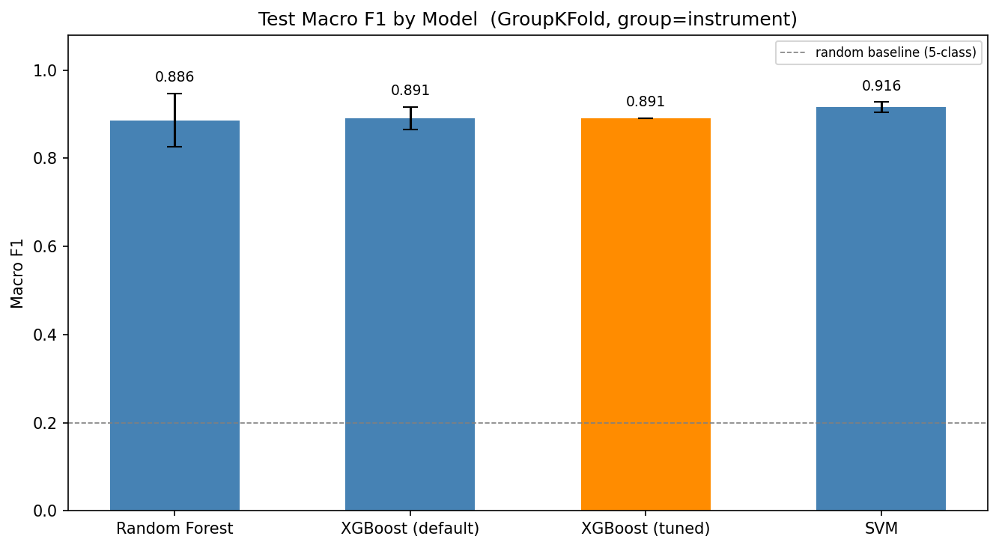
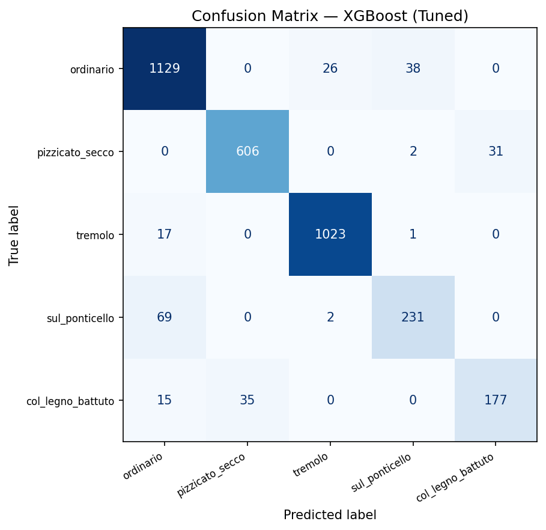
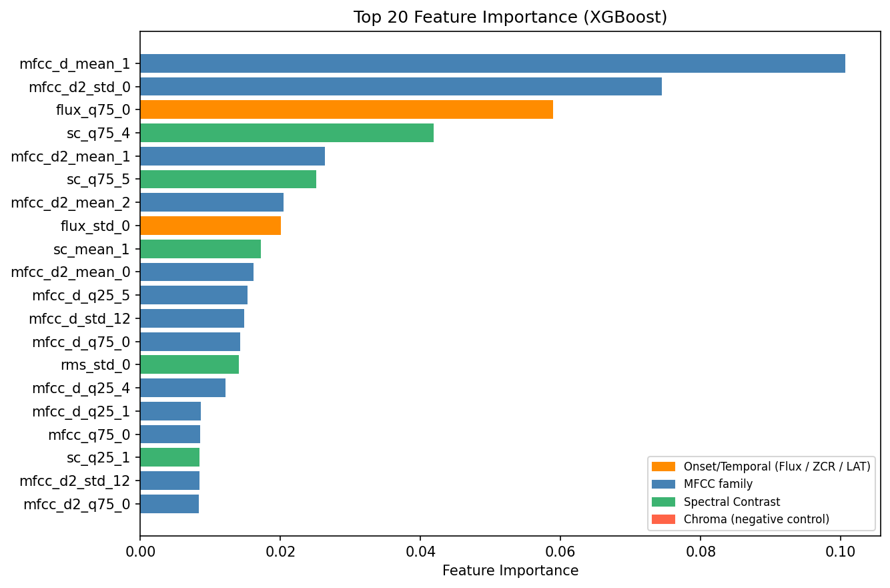
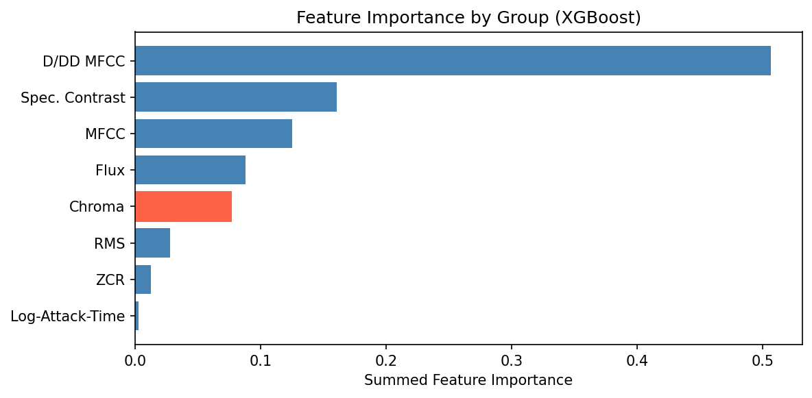
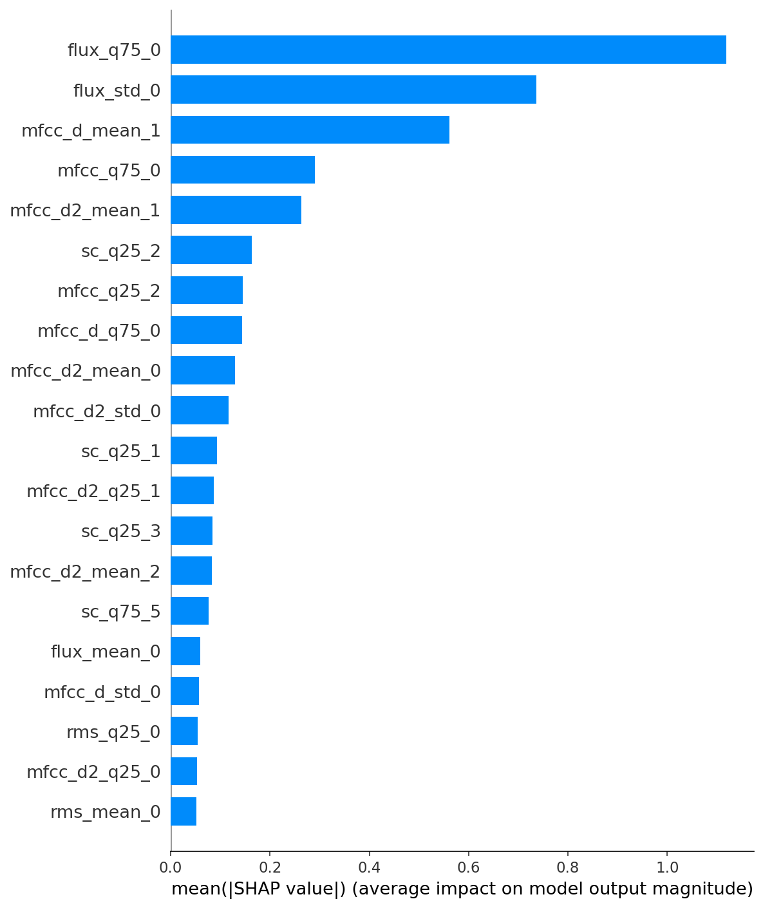
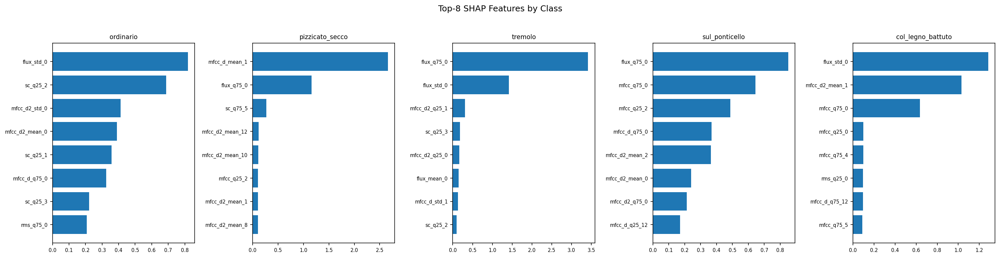
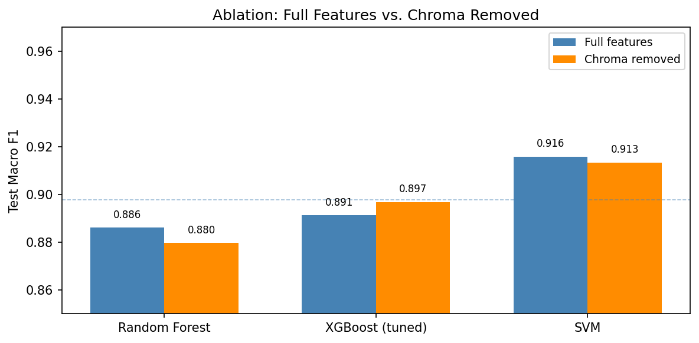

# v1 Results — Feature Engineering + Classical ML

## Dataset

| Item | Value |
|---|---|
| Source | OrchideaSOL (Strings) |
| Classes | ordinario, pizzicato_secco, tremolo, sul_ponticello, col_legno_battuto |
| Samples | 3,402 (natural class imbalance) |
| Instruments | Violin, Viola, Violoncello, Contrabass |
| Feature dim | 245 (full) / 197 (Chroma removed) |
| Validation | GroupKFold n=4, group=instrument (leave-one-instrument-out) |

---

## Model Performance

| Model | Test Macro F1 | Std | Note |
|---|---|---|---|
| SVM (RBF) | **0.916** | ±0.011 | Best and most stable |
| XGBoost (tuned) | 0.891 | ±0.000 | GridSearchCV CV score |
| XGBoost (default) | 0.891 | ±0.026 | Tuning gave negligible gain |
| Random Forest | 0.886 | ±0.060 | Highest variance across folds |

**Key observation:** SVM dominates at 3k — 자연 클래스 불균형 환경에서 마진 최대화 방식이 부스팅·배깅보다 견고하다. RF의 높은 분산(±0.060)은 어느 악기가 test fold로 빠지느냐에 따라 결정 경계가 크게 흔들린다는 의미.

XGBoost best params: `learning_rate=0.1, max_depth=3, n_estimators=300, subsample=0.8`

---

## Confusion Matrix

---

## Feature Importance

Top features overall: `mfcc_d_mean_1`, `flux_q75_0`, `mfcc_d2_mean_1`

**Unexpected:** Chroma (`chroma_q75_8/5/9/10`) appeared in 4 of the Top-20 features despite being designated as a negative control. See Ablation section below.

---

## SHAP Analysis

| Technique | Top SHAP features | Acoustic explanation |
|---|---|---|
| **pizzicato_secco** | `mfcc_d_mean_1`, `flux_q75_0` | Abrupt spectral energy change at pluck attack; sharp onset burst |
| **tremolo** | `flux_q75_0`, `flux_std_0` | Rapid repeated bow strokes → periodic onset bursts, high Flux peak and variance |
| **col_legno_battuto** | `flux_std_0`, `mfcc_d2_mean_1` | Irregular bow-stick impacts → highest Flux variance across all classes |
| **sul_ponticello** | `mfcc_q75_0`, `flux_q75_0` | Bowing near bridge enriches upper harmonics → elevated MFCC #0 upper quartile |
| **ordinario** | `sc_q25_1`, `sc_q25_2` | Stable harmonic structure → Spectral Contrast lower quartiles as discriminating signal |

---

## Ablation — Chroma Removal

| Model | F1 (full) | F1 (no Chroma) | Delta |
|---|---|---|---|
| Random Forest | 0.886 | 0.880 | -0.006 |
| XGBoost (tuned) | 0.891 | 0.897 | **+0.006** |
| SVM | 0.916 | 0.913 | -0.003 |

**Conclusion:** 변화 폭이 모두 1% 미만 — Chroma는 3k 자연 분포에서도 결정적 신호가 아님. XGBoost의 소폭 상승(+0.006)은 Chroma가 부스팅에서 노이즈로 작용했다는 의미.

**Root cause:** OrchideaSOL은 기법별로 녹음된 음역대가 다르다. 모델이 실제 음향 특성이 아닌 피치-기법 공분산을 학습할 위험이 있으며, Chroma는 이 허위 신호(spurious signal)의 대리 지표다.

**Implication for v2:** CNN은 전체 스펙트로그램을 입력으로 받아 Chroma 정보에 더 직접 노출된다. 피치 시프트 증강(±2 semitones)이 필요하다.

---

## Key Takeaways

1. **SVM이 최적 모델** — 정확도(0.916)와 안정성(±0.011) 모두 1위.
2. **Flux와 ΔMFCC가 핵심 특징** — 어택 패턴과 시간적 변화가 기법 변별의 핵심.
3. **Chroma는 spurious** — 데이터 분포 아티팩트, 실전 투입 시 제거 권장.
4. **모델 선택보다 특징 품질이 중요** — 전 모델이 ±3% 내에 밀집.
5. **v2 CNN 가설:** 멜 스펙트로그램이 수동 특징이 놓치는 시간적 미세 구조를 포착할 수 있지만, 피치 증강 없이는 동일한 함정에 빠진다.
