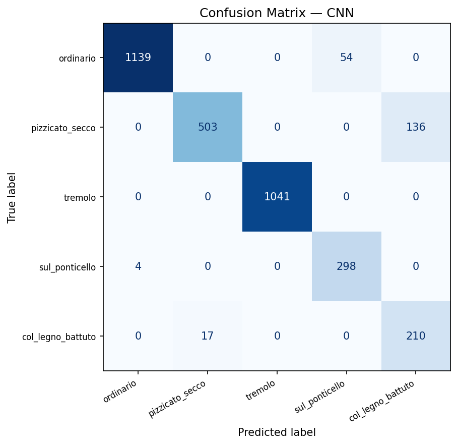

# v2 Results — Mel-Spectrogram + CNN

> 작성: 2026-06-15

## Dataset

| Item | Value |
|---|---|
| Source | OrchideaSOL (Strings) |
| Classes | ordinario, pizzicato_secco, tremolo, sul_ponticello, col_legno_battuto |
| Samples | 3,402 (natural class imbalance) |
| Instruments | Violin, Viola, Violoncello, Contrabass |
| Input | Mel-spectrogram (128 mel bins × 128 time frames) |
| Validation | GroupKFold n=4, group=instrument (leave-one-instrument-out) |

---

## Model Architecture — SmallCNN

```
Input: (batch, 1, 128, 128)
  ConvBlock1 (1→32,  pool=(2,1)):  (batch, 32,  64, 128)
  ConvBlock2 (32→64, pool=(2,1)):  (batch, 64,  32, 128)
  ConvBlock3 (64→128,pool=(2,1)):  (batch, 128, 16, 128)
  ConvBlock4 (128→128,pool=(2,1)): (batch, 128,  8, 128)
  GlobalAvgPool → 128-dim
  Dropout(0.5) → FC(128→64) → ReLU → Dropout(0.5) → FC(64→5)
```

**비대칭 풀링 설계 근거:** 멜 스펙트로그램에서 주파수 축(배음 구조)과 시간 축(어택 패턴)은 물리적으로 다른 정보를 담는다. `MaxPool2d((2,1))`로 주파수 축만 축소하여 128 time frame 전체를 보존한다.

학습 가능 파라미터: ~170K

---

## Training Setup

| Hyperparameter | Value |
|---|---|
| Optimizer | Adam (lr=1e-3, weight_decay=1e-4) |
| Scheduler | CosineAnnealingLR (T_max=30) |
| Loss | CrossEntropyLoss (class weight 보정) |
| Epochs | 30 per fold |
| Batch size | 32 |
| Augmentation | SpecAugment (주파수 마스킹 + 시간 마스킹) |

### 클래스 가중치 (class_weight='balanced')

| Class | Count | Weight |
|---|---|---|
| ordinario | 1,193 | 0.714 |
| tremolo | 1,041 | 0.819 |
| pizzicato_secco | 639 | 1.334 |
| sul_ponticello | 302 | 2.823 |
| col_legno_battuto | 227 | 2.997 |

---

## Model Performance

| Fold | Test Instrument | Macro F1 |
|---|---|---|
| 1 | Viola | 0.8868 |
| 2 | Violin | 0.8766 |
| 3 | Contrabass | 0.9008 |
| 4 | Violoncello | 0.9545 |
| **Mean ± Std** | | **0.9046 ± 0.0300** |

---

## Per-Class Results

| Class | Precision | Recall | F1 |
|---|---|---|---|
| ordinario | 1.00 | 0.95 | **0.98** |
| tremolo | 1.00 | 1.00 | **1.00** |
| sul_ponticello | 0.85 | 0.99 | **0.91** |
| pizzicato_secco | 0.97 | 0.79 | **0.87** |
| col_legno_battuto | 0.61 | 0.93 | **0.73** |
| **Macro avg** | 0.88 | 0.93 | **0.90** |

---

## Confusion Matrix



---

## Error Analysis

**col_legno_battuto (F1=0.73):** precision=0.61, recall=0.93 — 공격적 예측 경향.
class_weight=2.997으로 소수 클래스에 강한 페널티를 줬기 때문. 실제 col_legno를 거의 놓치지 않는 대신 다른 기법을 col_legno로 오분류하는 트레이드오프가 발생함.

**pizzicato_secco (F1=0.87):** recall=0.79 — 일부 pizzicato 샘플을 ordinario로 오분류.
OrchideaSOL에서 pizzicato는 음폭(dynamic)에 따라 소리 특성 차이가 크며, 약한 pizzicato가 ordinario와 혼동됨.

**tremolo (F1=1.00):** 완벽한 분류. 빠른 반복 보잉이 멜 스펙트로그램에서 주기적인 패턴으로 명확히 나타남.

---

## Key Takeaways

1. **Macro F1 0.9045** — v1 SVM(0.916)보다 낮지만 비슷한 수준.
2. **tremolo와 ordinario는 CNN이 가장 안정적으로 분류** — 멜 스펙트로그램이 시간적 주기 패턴을 잘 포착.
3. **col_legno_battuto는 여전히 어렵다** — 소수 클래스 + 타악적 어택이 현악기 오디오에서 비정형적으로 나타남.
4. **SpecAugment 효과:** 제한된 데이터(227~1,193개/클래스)에서 과적합 억제.
5. **fold 간 분산(±0.030) > v1 SVM(±0.011)** — CNN이 특정 악기(Violin/Viola 등) 타임브레 변화에 더 민감.

---

## v1 vs v2 비교 요약

| 항목 | v1 (SVM) | v2 (CNN) |
|---|---|---|
| 입력 | 245차원 수동 특징 | 128×128 멜 스펙트로그램 |
| 최고 Macro F1 | **0.916** | 0.905 |
| Fold 분산 | ±0.011 | ±0.033 |
| 학습 시간 | 수십 초 | ~수십 분 |
| 해석 가능성 | SHAP / Feature Importance | 낮음 |
| 추론 속도 | 매우 빠름 | 보통 |

**결론:** v1 SVM이 정확도·안정성·해석 가능성 모두 우세. 다만 CNN은 추가 데이터나 사전학습 기반(예: PANNs, AST)으로 확장 가능성이 높고, end-to-end 파이프라인이 가능하다는 장점이 있다.
