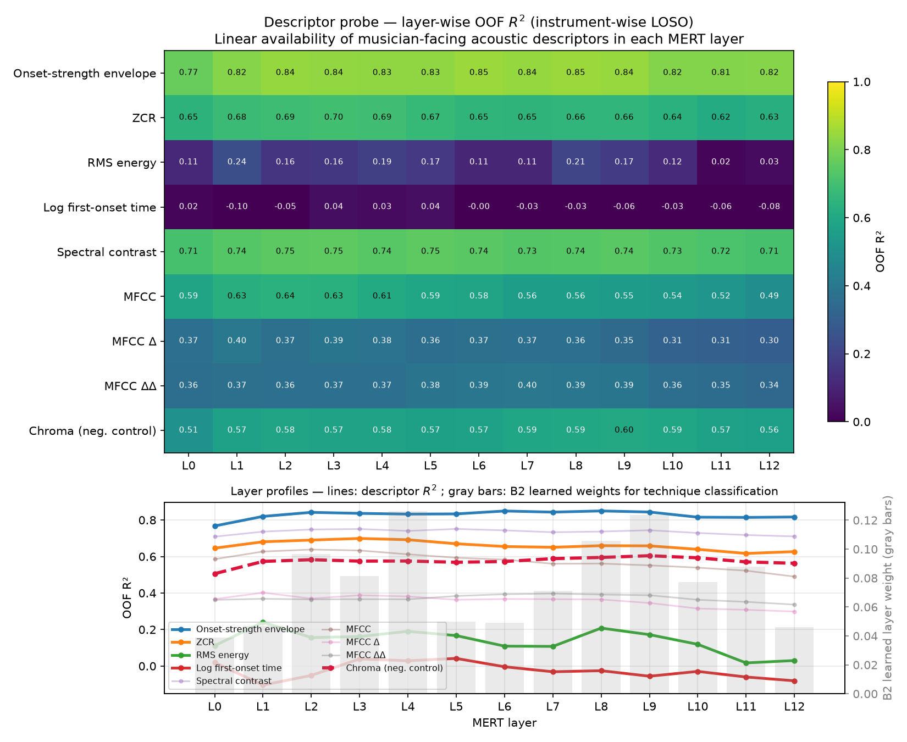
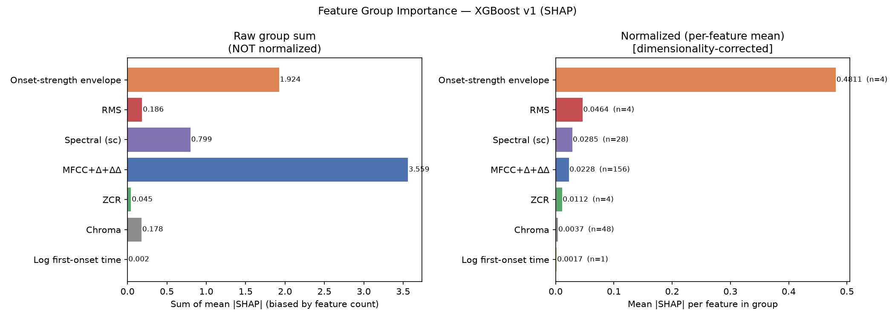
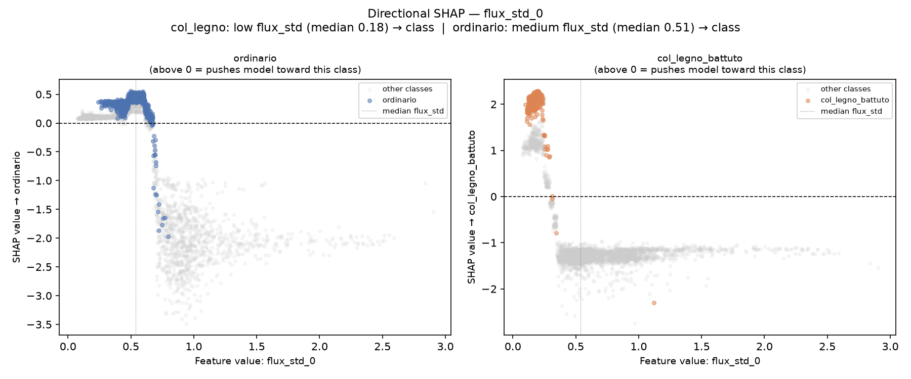
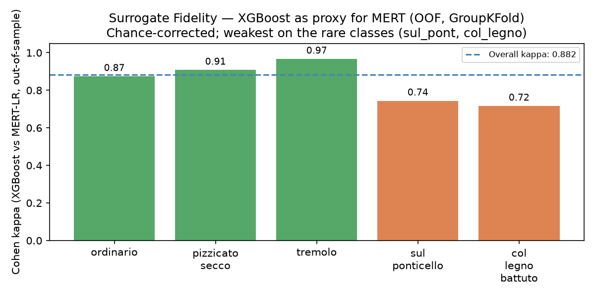

# When Foundation Models Only *Look* Better: Three Evaluation Pitfalls in Fine-Grained String Articulation Classification

> **Verification status (2026-09-28): This historical v0 draft is not a submission-ready result table.**
> The self-training before/after effect in Section 4.1 was not reproduced by the full
> rerun after removal of hidden-label access. Some later model figures also differ from
> canonical reruns. Use the verified MERT/SVM/CNN results and inference limits in
> [`results/phase1/canonical/verification/report.md`](../../notes/report.md).

## Abstract

Self-supervised audio foundation models are increasingly assumed to outperform handcrafted
acoustic features on music understanding tasks. We test this assumption on fine-grained string
articulation classification (five techniques — *ordinario, pizzicato secco, tremolo,
sul ponticello, col legno battuto* — on OrchideaSOL, evaluated leave-one-instrument-out). An
initial pipeline suggested a foundation-model (MERT) advantage under limited labels. Auditing
our own protocol, we find this advantage is an artifact of three evaluation pitfalls: (i)
selection-time test-set leakage in self-training, (ii) backbone undertuning, and (iii) a
mismatched resampling unit in uncertainty quantification. Removing the first two **flips the
conclusion twice**; the third, left uncorrected, would flip it a third time. After correction,
a tuned MERT head and a tuned SVM over 245-dimensional descriptors are **statistically
indistinguishable** across 5–50% label budgets (all gaps within ±0.7 fold-std, n=4). A
layer-wise descriptor probe explains why: the discriminative low-level cue (onset-strength
envelope) is already linearly recoverable at MERT's convolutional front-end (R²=0.77, before
any transformer layer), and depth adds mainly harmonic abstraction this task does not require.
The conclusion holds even when the backbone itself is fine-tuned: a larger tuning budget does
not improve MERT. Our contribution is not a new state-of-the-art model but a reproducible account of three
pitfalls, a practical checklist, and a scoped negative result: for low-dimensional
strong-signal, small-data fine-grained tasks, heavy models offer no practical gain.

---

## 1. Introduction

Automatic recognition of instrumental playing techniques is a core problem in music information
retrieval, with applications in performance analysis, music education, and expressive-content
indexing. String articulations in particular carry fine acoustic distinctions — the bow
striking the string (*col legno*), bowing near the bridge (*sul ponticello*), rapid re-bowing
(*tremolo*). As self-supervised audio foundation models (e.g., MERT) achieve strong results
across MIR benchmarks, a common expectation is that such models also dominate fine-grained
technique classification, rendering handcrafted acoustic features obsolete.

We show this expectation is easy to *manufacture* and hard to *verify*. Small, individually
reasonable evaluation choices can inflate an apparent foundation-model advantage without any
real modeling gain. We isolate three such choices that arose in our own pipeline and quantify
each with a before/after comparison.

*(i) Selection-time test-set leakage.* Choosing the self-training iteration (or a decision
threshold) by test-set F1 leaks the target into model selection; removing it drops
self-training macro-F1 by up to 0.107 at the 5% label budget and erases an apparent SVM–MERT
crossover. *(ii) Backbone undertuning.* A single linear head on the last hidden state
understates the backbone; a convention-matched search (MLP / layer-weighted head, disjoint
selection val) raises tuned MERT by 0.025–0.046. *(iii) Resampling unit in uncertainty
quantification.* A BCa bootstrap that resamples only test clips — holding folds fixed — reports
SVM as significantly ahead at 5% and 20%; resampling at the correct unit (instruments/folds, the
dominant variance component for a cross-instrument claim) returns confidence intervals that cover
zero everywhere. Pitfalls (i) and (ii) each **flipped our conclusion** — first away from, then back toward
the foundation model; (iii) was caught before it flipped it a third time.

With all three controlled, and under **equal training data**, tuned MERT and a tuned
245-dimensional SVM are indistinguishable across label budgets (5–50%; all gaps within ±0.7
fold-std). A layer-wise descriptor probe locates the reason: the onset-strength envelope that
separates these techniques is already linearly present at MERT's convolutional front-end
(R²=0.77, pre-transformer), and the twelve transformer layers add almost nothing to its band
average (+0.008, peaking only +0.083 above the front-end); the only descriptor that *gains* with
depth is chroma — harmonic abstraction this articulation task does not need. The heavy model has
nothing task-relevant to add that the front-end has not already exposed.

Our contributions are: (1) a reproducible account of three evaluation pitfalls in fine-grained
audio classification, each with a before/after quantification on the same data; (2) a
practitioner checklist for avoiding them; and (3) a scoped negative result — on low-dimensional,
strong-signal, small-data fine-grained tasks, self-supervised foundation models yield no
practical advantage over well-tuned handcrafted features — supported by a mechanistic
layer-wise analysis rather than accuracy alone.

---

## 2. Related Work

We organize prior work along two axes: *what is classified* (§2.1, the feature/model lineage of
string playing-technique recognition) and *how it is evaluated* (§2.2, the SSL/semi-supervised
evaluation-pitfalls literature). §2.3 bridges them with a coding of prior technique-classification
work along evaluation-practice axes, exposing the gap our three pitfalls occupy.

### 2.1 Playing-technique classification

**Handcrafted acoustic features on bowed strings.** The task closest to ours is instrument
playing-technique (IPT) classification on bowed strings from audio. Su et al. [1]
classify nine techniques on exactly the four instruments we use (violin, viola, cello,
contrabass), showing that phase-derived features (group-delay, instantaneous-frequency) with
sparse coding lift macro-F1 from 0.835 (magnitude-only) to 0.915 — but also that cross-corpus
transfer (RWC → real recordings) collapses to 0.547. Kruger & Jacobs [2] classify
up to eleven techniques with an SVM over handcrafted features on RWC under a random 70/30 split.
Barbancho et al. [3] detect six violin techniques with a hand-built decision
flowchart (no learning). These establish that (a) fine articulation distinctions are carried by
low-level spectral/temporal cues, and (b) generalization *across recording sources* is the hard
part — the tension our leave-one-instrument-out protocol targets.

**Scattering-transform and multi-scale lineage.** A second line argues MFCCs miss the
amplitude/frequency modulation that defines many techniques (tremolo, vibrato), and replaces
them with (joint time-frequency) scattering transforms. Lostanlen et al. [4]
introduce this on SOL — the dataset underlying our OrchideaSOL — and frame IPT as harder than
instrument recognition. Wang et al. extend adaptive scattering to Chinese bamboo flute [5, 6], reporting macro-F1 79.9% vs 35.9% for MFCCs. Ducher & Esling [7] decompose cello IPT into orthogonal axes and cross-validate over five soundbanks
(their *minus-1db* protocol), showing a flat 18-way classifier fails (41.5%) where a
taxonomy-aware CQT-RCNN reaches 57.6%. This lineage motivates our *Chroma-as-control* ablation
and our reading of `col legno battuto` as a technique that moves several acoustic axes at once.

**Spectrogram-CNN and onset-fusion.** On the deep-learning side, frame-level detectors on
Guzheng and Erhu [8, 9, 10] show that fusing note-onset
information roughly doubles note-level F1 (39.5% → 80.8%), directly evidencing that *attack/onset*
cues dominate IPT — consistent with our SHAP finding that the onset-strength envelope is the
single most important feature. CNN-on-spectrogram studies on violin bowing [11] and electric guitar [12] report >90% accuracy but under
generalization-weak evaluation designs — [11] uses a mixed-source random 5-fold and never tests
held-out generalization, while [12] reports high accuracy under same-data testing but drops to ~71%
on the authors' own held-out real recordings (YouTube).

**Self-supervised pretraining on IPT.** Closest to the "foundation model" question, MERTech
[13] fine-tunes MERT-v1-95M — the same backbone we use — for multi-task
IPT/pitch/onset, reaching SOTA on Guzheng (MI-F1 90.0%) yet only 53.36% on violin RWC technique
classification; VioPTT [14] surpasses it (77.22%) via synthetic augmentation but
covers only four techniques (excluding col legno, tremolo, sul ponticello). Both report accuracy
on a single task and do **not** compare the SSL model against a tuning-matched handcrafted
baseline — precisely the comparison our audit isolates.

**Motion / multimodal (context).** A distinct branch classifies bowing gestures from
IMU/MOCAP/EMG rather than audio [15, 16], often
exceeding 99% but typically with a single performer (N=1) and fixed 80/20 splits, and with motion
dominating audio. We note these only to bound scope: our claim is about *audio-only*
classification, where the technique boundary is acoustically — not kinematically — defined.

### 2.2 Evaluation pitfalls, semi-supervised learning, and SSL probing

**Tuned baselines and realistic SSL evaluation.** Our central methodological ancestor is Oliver
et al. [17], who show in the image domain that once baselines are properly tuned,
the apparent benefit of semi-supervised learning shrinks dramatically. We port this warning to
audio/MIR in the foundation-model era and add a failure mode they do not treat: **selection-time
leakage** from choosing the self-training iteration / confidence threshold by test performance.
Musgrave et al. [18] make a parallel "reality check" for metric learning,
attributing inflated gains to weak baselines and flawed protocols.

**Leakage as a general failure mode.** Kapoor & Narayanan [19] document leakage
across 294 papers in 17 fields and propose a reporting taxonomy; our pitfall (i) is an instance
of their "test-set information used in model selection" category, localized to self-training and
quantified with a before/after table. We adopt their *model info sheet* as the template for our
§6 checklist.

**Resampling unit and variance decomposition.** Bouthillier et al. [20] argue that
a valid benchmark must model *all* sources of variance; fixing some (e.g., data split) while
resampling others fabricates significance. This is the general theory behind our pitfall (iii):
a bootstrap that resamples only test clips while holding folds fixed narrows the interval 2.6–5.0×
and reports a difference that vanishes once the dominant cross-instrument variance component is
resampled at the fold unit.

**Layer-wise probing and control tasks.** Pasad et al. [21] show, layer-by-layer,
that a wav2vec2-style speech model's early layers mirror low-level acoustics (mel-filterbank-like)
while upper layers encode global/semantic structure. As MERT is architecturally the same family,
this is the direct precedent for our descriptor probe, where the onset-strength envelope saturates
at the convolutional front-end (R²=0.77) before any transformer layer. Hewitt & Liang [22] justify pairing probes with control tasks so a probe reads representations rather than
learning the task itself — the rationale for keeping our probes low-capacity and our Chroma control
in place.

**Probing conventions in music SSL benchmarks.** Standardized SSL benchmarks — MARBLE [23] for music, USB [24] for SSL broadly — matter to our pitfall (ii) in a
specific way: MARBLE's probing head is an MLP (hidden 512), not a single linear layer. Thus the
"convention" does not undertune the backbone; *we* did, by starting from a last-layer
single-linear head. Pitfall (ii) is therefore not "the field undertunes SSL" but "probe design
(head capacity, layer selection) can flip the conclusion, and we fooled ourselves once by sitting
below convention." MERT itself [25] is the backbone under test. Fine-tuning under
distribution shift is treated by Kumar et al. [26], whose LP-FT effect we invoke in
§4.4.

### 2.3 Positioning: an evaluation-practice coding of prior IPT work

We code the §2.1 studies along three *evaluation-practice* axes: **(A) source/instrument-disjoint
evaluation** (random splits invite optimism), **(B) comparison of a heavy model against a
tuning- and budget-matched cheap baseline**, and **(C) uncertainty reported at the unit of the
generalization claim**. As the table shows, some studies satisfy (A) well, but **none satisfies
(B) and (C) together** — the gap our three pitfalls occupy.

| Prior work | Domain | (A) Source/instr.-disjoint | (B) Heavy vs *tuned* cheap, equal budget | (C) Uncertainty at claim's unit |
|---|---|---|---|---|
| Su et al. 2014 [1] | violin/viola/cello/CB | ~ cross-corpus (RWC→real) | ✗ (no deep/SSL) | ✗ |
| Barbancho 2009 [3] | violin | ✗ (pooled) | ✗ (rule-based) | ✗ |
| Kruger & Jacobs 2020 [2] | bowed string | ✗ random 70/30 | ✗ (SVM only) | ✗ |
| Lostanlen 2018 [4] | SOL (all fam.) | ~ held-out | ✗ (scattering vs MFCC only) | ✗ |
| Ducher & Esling 2019 [7] | cello | ✓ 5 soundbanks (minus-1db) | ✗ (no cheap baseline audit) | ✗ |
| Wang 2020/2022 [5, 6] | CBF | ~ held-out | ✗ (scattering+SVM) | ✗ |
| Guzheng/Erhu 2019–2023 [8, 9, 10] | Chinese strings | ✓ VSB→RW (synth→real) | ✗ | ✗ |
| Alar 2021 [11] | violin bowing | ✗ mixed-source random 5-fold | ✗ | ✗ |
| MERTech 2024 [13] | multi (incl. violin) | ~ dataset-standard | ✗ (SSL only, no tuned SVM) | ✗ |
| VioPTT 2025 [14] | violin | ~ synth→RWC | ✗ (SSL/CRNN only) | ✗ |
| SpectroFusionNet 2025 [12] | e-guitar | ✗ same-data test | ✗ | ✗ |
| **This work** | **violin/viola/cello/CB** | **✓ LOSO (instrument-grouped)** | **✓ tuned MERT vs tuned 245-d SVM, matched budget** | **✓ 2-level BCa (instrument-resampled)** |

> ✗ = not met, ~ = partial/implicit, ✓ = explicitly met. A `~` in (A) denotes source separation
> weaker than our LOSO, or a synthetic→real special case.

---

## 3. Data and Method

### 3.1 Data

We use the string subset of **OrchideaSOL** [27], a library of isolated instrumental notes. We
retain five bowed-string articulation classes — *ordinario, pizzicato secco, tremolo,
sul ponticello, col legno battuto* — across four instruments (violin, viola, violoncello,
contrabass), yielding **3,402 clips** with the class distribution in Table 3.1. The set is
imbalanced (ordinario 1,193 to col legno battuto 227), motivating macro-F1 as the primary metric.

| Class | n | mean dur (s) |
|---|---|---|
| ordinario | 1,193 | 7.16 |
| tremolo | 1,041 | 7.25 |
| pizzicato secco | 639 | 1.36 |
| sul ponticello | 302 | 7.61 |
| col legno battuto | 227 | 2.71 |

We deliberately do **not** use TinySOL (ordinario only) and note that clip duration itself carries
class information (§4.4/§5); durations are reported for transparency, not used as a feature except
in the confound-control baseline.

### 3.2 Evaluation protocol: leave-one-instrument-out

All models are evaluated under **instrument-grouped GroupKFold (leave-one-instrument-out, LOSO)**:
four folds, each holding out one instrument entirely for testing. This prevents notes from the
same instrument/recording appearing in both train and test — the optimistic bias random splits
incur on this data. Grouping keys are the recording identifiers parsed by
`features.py::parse_recording_id`. Because the generalization claim is across *instruments*, the
instrument/fold is the correct unit for both training splits and uncertainty (§3.5).

To study limited-label regimes we sample labeled **seed budgets of 5/10/20/50%** (per fold, 3
random trials, averaged). To avoid selection-time leakage (§4.1), each seed is split **three
ways**:

```
labeled seed ─┬─ val_select 20%   → hyperparameter/config selection ONLY (disjoint, fixed)
              └─ seed_core 80% ─┬─ tr     80%  → training
                                └─ es_val 20% → early-stopping ONLY
```

`val_select ∩ es_val = ∅`, and both are disjoint from the LOSO test fold. Model selection
(config, iteration, threshold) touches **only** `val_select`; early stopping touches **only**
`es_val`; nothing touches test. For the SVM (no early stopping) we report the equal-training-data
condition (`tr`, 64% of labeled) as the primary comparison and the `seed_core` condition (80%) as
a sensitivity variant.

### 3.3 Features and models

**Handcrafted (v1).** We extract a **245-dimensional** descriptor vector per clip (`features.py`).
Frame-level descriptors are aggregated over time by four statistics — **mean, std, Q25, Q75** — to
preserve temporal variation a mean alone discards. The vector comprises MFCC+Δ+ΔΔ (156), Chroma
(48), spectral contrast (28), onset-strength envelope (4), RMS energy (4), zero-crossing rate (4),
and log-first-onset-time (1). Chroma (pitch-class) is retained deliberately as a **negative
control**. Classifiers: **SVM (RBF)** — the primary model — with XGBoost and random forest as
alternates; XGBoost additionally serves as the SHAP surrogate (§3.6).

**Spectrogram CNN (v2).** As a deep baseline on the same LOSO protocol, we train a small CNN
(`model.py`) on log-mel spectrograms (`dataset.py`), with SpecAugment and an **asymmetric (2,1)
pooling** that halves only the frequency axis to preserve temporal resolution.

**Self-supervised backbone (MERT).** We use **MERT-v1-95M** [25] via HuggingFace `transformers`
(`AutoModel`, `trust_remote_code`), resampling audio to 24 kHz. Embeddings are the mean-pooled
hidden states over time (batch=1, no padding, matching the cached-embedding pipeline exactly); all
**13 hidden states** are retained for the probe and the layer-weighted head — in HuggingFace
`hidden_states` indexing, **L0 is the feature-projection output following the convolutional feature
encoder** (*before* the first transformer block) and **L1–L12 are the twelve transformer layers**.
Throughout, "convolutional front-end (L0)" refers to this pre-transformer state. On top we train a classification
**head** — a single linear layer, an MLP-256, or a learned convex combination over layers
("layer-weighted"). A **CLAP zero-shot** classifier (`laion/clap-htsat-unfused`) provides a
no-label reference point. The heaviest tuning point, **LoRA** (r=8, α=16, on q/v projections),
adapts the backbone itself (§4.4). All models run on Apple-Silicon MPS with CPU fallback; no CUDA,
no bitsandbytes.

### 3.4 Tuning budgets

To make the SVM-vs-MERT comparison fair, both are tuned on `val_select` (never on test). The SVM
searches **12 configurations** (C ∈ {0.1,1,10,100} × γ ∈ {scale,0.01,0.001}); the MERT head
searches **24** (arch ∈ {linear, mlp256} × lr × weight-decay × dropout) — a *larger* budget for
the backbone, guarding against undertuning it (§4.2).

### 3.5 Uncertainty quantification

We report a **BCa bootstrap** (B=2,000, 95%). Because clips from one recording are strongly
correlated, we resample at the **recording-cluster** level rather than the clip level. Critically,
since the claim generalizes across instruments, we also report a **two-level** bootstrap that
resamples the **instrument/fold** unit — the dominant variance component — and treat *its*
zero-coverage as the significance test (§4.3). With four instruments these intervals are
necessarily wide; that width is the honest answer, not a defect to hide.

### 3.6 Interpretability: descriptor probe and SHAP

Two analyses explain *why* (§5). **(a) Layer-wise descriptor probe:** for each MERT layer we
ridge-regress each handcrafted descriptor from the 768-d embedding (LOSO, out-of-fold R²,
`RidgeCV` per target on train only), reading each layer as "how linearly available is this
descriptor here." Chroma serves as a control, following the control-task rationale of Hewitt &
Liang [22]. **(b) SHAP:** we compute SHAP values on the XGBoost surrogate, report
**dimensionality-corrected** (per-feature) group importances, and validate the surrogate against
the MERT head **out-of-sample** (Cohen's κ), reporting fidelity honestly rather than the
misleading in-sample agreement.

---

## 4. Results

We report each pitfall as a before/after pair on the same data, in the order we encountered it.
Pitfalls (i) and (ii) each *reversed* our working conclusion; pitfall (iii) would have reversed it
a third time but was caught before it entered any reported result. §4.4 states the corrected,
stable conclusion. Throughout, macro-F1 is averaged over four instrument-grouped folds (LOSO;
violin / viola / cello / contrabass) across label budgets of 5/10/20/50%. Unless noted, MERT and
SVM are trained on **identical data** (the 64% `tr` partition); a sensitivity variant (`seed_core`,
80%) is reported where the two differ.

### 4.1 Pitfall (i): selection-time test-set leakage — *first reversal*

Our initial self-training pipeline selected the iteration (and confidence threshold τ) by test-set
macro-F1. Removing this — selecting on a disjoint held-out split instead — lowers self-training
macro-F1 across every budget, most at low label counts (Table 4.1):

| Label budget | Leaked (selected on test) | De-leaked | Δ |
|---|---|---|---|
| 5%  | 0.745 | 0.638 | **−0.107** |
| 10% | 0.817 | 0.739 | −0.078 |
| 20% | 0.837 | 0.798 | −0.039 |
| 50% | 0.857 | 0.829 | −0.028 |
| cross-domain (Phase 4) | 0.461 | 0.449 | −0.012 |

> The first four rows (5–50%) are the same-domain seed-budget condition. The final "cross-domain"
> row is a different setting — the same de-leaking audit applied to Phase 4's off-domain pool
> (Philharmonia transfer) — placed alongside for reference; it shows the direction of the de-leaking
> effect (negative) is consistent across domains.

The drop grows as labels shrink (−0.107 at 5%), showing the "iteration-selection gain" was largely
leaked test signal, worst where the selection split is tiny (~25 samples). Crucially, the leak had
produced an apparent **crossover**: in the leaked pipeline MERT+self-training exceeded the SVM at
the 5–10% budgets, supporting a "foundation models win under limited labels" reading. After
de-leaking, the SVM matches or exceeds MERT+self-training at *every* budget, and self-training no
longer beats even its own MERT baseline at 5% (0.638 vs 0.726). **The crossover — and the
conclusion resting on it — disappears.** For reference, the no-label baseline of §3.3 — the CLAP
zero-shot classifier — stays at macro-F1 **0.363** (constant across seeds), far below every trained
model; it fixes the "zero-label" floor and confirms the numbers above come from actual learning.

### 4.2 Pitfall (ii): backbone undertuning — *second reversal*

The de-leaked result above used a single linear head on MERT's last hidden state — below common
probing convention (e.g., MARBLE's MLP-512). Matching convention with a proper head search (arch
∈ {linear, mlp256} × lr × weight-decay × dropout = 24 configs, all selected on a **disjoint**
`val_select` split, giving MERT a *larger* search budget than the SVM's 12) raises tuned MERT over
its default by **+0.025 to +0.046**. Under equal training data, tuned MERT and tuned SVM become
statistically indistinguishable — every gap falls within ±0.7 fold-std (Table 4.2):

| Label budget | SVM (tuned, tr) | MERT (frozen-tuned head, tr) | MERT − SVM | in fold-std |
|---|---|---|---|---|
| 5%  | 0.6613 ± 0.053 | 0.6714 ± 0.040 | **+0.0101** | +0.21σ |
| 10% | 0.7542 ± 0.078 | 0.7477 ± 0.037 | −0.0065 | −0.11σ |
| 20% | 0.8316 ± 0.039 | 0.8074 ± 0.030 | −0.0242 | −0.69σ |
| 50% | 0.8681 ± 0.040 | 0.8593 ± 0.025 | −0.0088 | −0.26σ |

The MERT here is a **head on the frozen backbone** (the per-fold best of the linear/mlp256 search)
and is identical to the "frozen-tuned" column of Table 4.4 in §4.4; at this point MERT sits just
below the SVM at 20% and 50%. §4.4 extends the same tuning-budget spectrum to a **layer-weighted
head** — MERT's *fair ceiling* — where MERT instead matches or slightly exceeds the SVM (Table 4.4).
That is, as head capacity rises toward convention the gap narrows from an SVM tilt to a tie, and at
no point does it exceed ±0.7 fold-std.

This **reverses the §4.1 verdict a second time**: the "SVM wins everywhere" conclusion was itself
an artifact — of undertuning the backbone, not of the data. Two points guard against over-claiming.
First, the correct head is *budget-dependent*: at low labels the search prefers a plain linear head
(5%: 9/12 folds linear; 10%: 8/12), splits evenly at 20%, and prefers mlp256 only at 50%. The
lesson is not "convention undertunes SSL" but "probe design can flip the conclusion, and we sat
below convention and fooled ourselves once." Second, if the SVM is allowed its structural
advantage — it needs no early-stopping split and can train on the full `seed_core` 80% — it edges
ahead everywhere (up to −1.04σ at 10%), but still within ~1σ at n=4, a tilt rather than a reversal.

### 4.3 Pitfall (iii): resampling unit in uncertainty quantification — *a near-miss*

Having landed on parity, we quantified it with a BCa bootstrap (B=2000). Resampling at the
**recording-cluster** level while holding the four instrument folds fixed, the paired MERT−SVM
interval **excludes zero at the 5% and 20% budgets** (−0.027 [−0.044, −0.012] and −0.026 [−0.043,
−0.011]), reading as "SVM significantly ahead" — in tension with the parity of §4.2. But this
interval models only test-clip sampling variance; the folds — the axis our leave-one-instrument-out
claim generalizes over — are fixed. A generalization claim across instruments must resample at the
instrument/fold unit. Doing so (a two-level bootstrap) widens the intervals **2.6–5.0×** and every
paired interval now **covers zero** (Table 4.3):

| Label budget | MERT − SVM | 1-level CI (clip) | 0? | 2-level CI (fold) | 0? |
|---|---|---|---|---|---|
| 5%  | −0.027 | [−0.044, −0.012] | no  | [−0.107, +0.050] | **yes** |
| 10% | −0.000 | [−0.016, +0.015] | yes | [−0.071, +0.069] | **yes** |
| 20% | −0.026 | [−0.043, −0.011] | no  | [−0.074, +0.035] | **yes** |
| 50% | −0.007 | [−0.021, +0.006] | yes | [−0.046, +0.025] | **yes** |

Had we reported the clip-level interval, we would have flipped the conclusion a **third** time —
back to "SVM significantly wins." Unlike (i) and (ii), this pitfall never entered a reported
result: we caught it before publication. We flag it precisely because it is *harder* to catch — it
arises from adopting a more rigorous method (a cluster bootstrap) and stopping one level too
shallow. The wide fold-level intervals (n=4 instruments) are not a weakness to hide but the honest
answer to "would this hold on other instruments?"

### 4.4 Landing: conditional parity

Removing all three pitfalls, the corrected picture is **conditional parity**: a tuned
245-dimensional SVM and a tuned MERT head are statistically indistinguishable across 5–50% label
budgets (all gaps within ±0.7 fold-std, §4.2; all fold-level intervals cover zero, §4.3). We rule
out a duration confound — that the SVM merely exploits clip-length differences — with a length-only
baseline (single duration feature), which reaches only macro-F1 0.400 under LOSO versus 0.906 for
the full 245-dimensional feature set (a 0.506 gap). Moreover, regressing the duration component out
of the features leaves performance essentially intact (0.906 → 0.893), and the onset-family
features actually *rise* after residualization (0.673 → 0.694); a mere length proxy would have
collapsed.

**Does a larger tuning budget rescue the backbone?** A natural objection to §4.2 is that we only
tuned a *frozen* head — perhaps adapting the backbone itself would open a gap for MERT. It does not;
it does the opposite. We place five points on a single tuning-budget spectrum (Table 4.4): SVM →
frozen-linear head → frozen-tuned head → learned layer-weighting → LoRA adaptation of the backbone
(r=8, q/v projections).

| seed | SVM (tuned) | frozen-linear | frozen-tuned | layer-weighted | LoRA |
|---|---|---|---|---|---|
| 20% | 0.832 | 0.776 | 0.807 | **0.855** | 0.804 |
| 50% | 0.868 | 0.814 | 0.859 | **0.900** | 0.775 |

Two readings follow. First, the *fair ceiling* for MERT is the tuned frozen probe (layer-weighted):
it matches or slightly exceeds the SVM (0.855 vs 0.832 at 20%; 0.900 vs 0.868 at 50%) — the same
"convention-matched probing reaches parity" result as §4.2, now at the top of the spectrum. Second,
adapting the backbone with LoRA does **not** continue the climb; it *regresses* — below even the
frozen-tuned head, and worse with more data (0.804 at 20% → 0.775 at 50%), while its
early-stop-val F1 stays high (0.90–1.0). This is the signature of fine-tuning **distorting**
pretrained features under distribution shift: our LOSO protocol tests on an unseen instrument,
exactly the out-of-distribution regime where full fine-tuning underperforms linear probing (the
LP-FT effect, Kumar et al. [26]). So the "you simply did not fine-tune hard enough"
objection is answered in the strongest form: fine-tuning harder makes MERT *worse* here, not
better. We report a single LoRA configuration, not a grid — a limitation noted in §6 — but we
read this regression as a **consistent directional signal of the LP-FT effect under OOD
evaluation**, not an artifact of one setting: both the inverted data-scaling (worse with more
data) and the wide train–test gap are exactly the direction that feature distortion predicts.

The parity is *conditional*, not universal: a claim about tasks whose discriminative signal is
concentrated in a few low-level acoustic descriptors, not about MIR at large. §5 explains,
mechanistically, *why* depth adds nothing here.

---

## 5. Discussion

§4 established *that* a tuned MERT head and a tuned SVM are indistinguishable on this task. This
section asks *why*, and reports two honest negative results that bound the claim.

### 5.1 Why depth does not help: a layer-wise descriptor probe

To locate what the backbone contributes, we regress handcrafted acoustic descriptors from each
MERT layer's embedding (ridge, LOSO, out-of-fold R²) — reading each layer as "how linearly
available is this descriptor here." The pattern explains the parity (Table 5.1):

| Descriptor (role) | R² at L0 (conv front-end) | peak layer | R² at peak | high−low band |
|---|---|---|---|---|
| Onset-strength envelope (core cue) | **0.767** | L8 | 0.850 | +0.008 |
| Spectral contrast (mid) | 0.709 | L5 | 0.751 | −0.009 |
| MFCC (mid) | 0.585 | L2 | 0.638 | **−0.086** |
| Chroma (negative control) | 0.506 | L9 | 0.604 | **+0.023** |



**Figure 1. Layer-wise descriptor probe (LOSO out-of-fold R²).** Top: heatmap of how linearly
available each acoustic descriptor is at each MERT layer (L0–L12). Bottom: the same values as line
profiles (gray bars = learned layer weights for technique classification, §5.3). The task's core
cue, the onset-strength envelope, already saturates at L0 (the convolutional front-end) at R²=0.77;
the only descriptor that consistently gains with depth is the chroma negative control.

Three things stand out (Figure 1). **(1)** The task's dominant cue — the onset-strength envelope — is already
almost fully linearly present at the *convolutional front-end* (R²=0.767 at L0, before any
transformer layer), and the twelve transformer layers add essentially nothing to the band average
(+0.008); its peak (0.850 at L8) exceeds L0 by only +0.083. **(2)** MFCC — timbral detail —
actually *degrades* with depth (−0.086). **(3)** The only descriptor that consistently *gains* with
depth is Chroma (+0.023), i.e. pitch-class / harmonic abstraction — and Chroma is our negative
control, near-zero in SHAP importance (§5.2) because articulation is pitch-invariant. So the
representational work the transformer stack performs is largely orthogonal to what this task needs:
the discriminative signal sits at the front-end that any mel-style feature extractor (including our
SVM's inputs) also sees, while depth buys harmonic abstraction the task discards. This is the
audio-articulation counterpart to Pasad et al.'s [21] layer-wise finding in speech, and the
mechanistic reason a heavy backbone offers no practical gain here.

A companion probe-configuration analysis reinforces this from the modeling side: matching probing
convention (best-layer / layer-weighted head vs a last-layer linear head) raises MERT by a
consistent **+0.039–0.047**, whereas the model-family effect at equal budget is only **−0.002 to
+0.035** (sign-inconsistent). *Probe design moves the number more than the choice of model family
does* — the MIR instance of Musgrave et al.'s [18] "tuning-budget effects exceed method effects,"
and a direct quantification of why pitfall (ii) was able to flip the conclusion.

The same mechanism explains why *deeper* adaptation backfires (§4.4). If the task-relevant signal
is already exposed at the front-end and the depth encodes abstraction the task discards, then
fine-tuning the backbone on a small in-distribution training set has little useful signal to
sharpen and ample opportunity to overfit — distorting the very front-end features the frozen probe
relied on. Under our cross-instrument (out-of-distribution) LOSO test this manifests as LoRA falling
below the frozen-tuned probe and degrading with more data, the LP-FT effect of Kumar et al. [26].
The probe result is thus not just descriptive: it *predicts* that parameter-efficient fine-tuning
cannot help — and can hurt — on this task.

### 5.2 What the cheap features encode: SHAP against musician knowledge

If depth inside MERT is unnecessary, what *physical substance* of the sound do the handcrafted
features — the ones that matched MERT — actually grasp? To answer this we interpret them through
a fidelity-checked surrogate (XGBoost, §3.6), which lets us read feature attributions we cannot
read off the SVM directly. A dimensionality-corrected SHAP analysis (per-feature mean over the
surrogate) ranks the **onset-strength envelope first by a wide margin** (0.481 per feature vs 0.046 for the next group, RMS), with Chroma
second-to-last (0.004) — exactly the ordering the probe predicts, and what a string player would
expect: articulation is defined by *how the note begins and evolves*, not by *which pitch* it is.
The direction of the top flux feature aligns with physical intuition per class: `col legno battuto`
occupies **low** flux variance (a single dry wood-on-string strike, median flux_std 0.18),
`tremolo` occupies **high** flux variance (rapid re-bowing, high flux_q75), and `ordinario` sits at
a **medium** level near `sul ponticello` — the very adjacency that makes those two the hardest to
separate (Figures 2 and 3).



**Figure 2. Dimensionality-corrected SHAP group importance (XGBoost surrogate).** Left: raw sum
(biased by feature count, inflating the MFCC family); right: per-feature mean (dimensionality-
corrected). The onset-strength envelope leads by a wide margin (0.481 per feature); chroma is near
the bottom (0.004).



**Figure 3. Directional SHAP for flux_std_0.** `col legno battuto` is pushed toward its class at low
flux variance (median 0.18), `ordinario` at a medium level (median 0.51) — the SHAP direction
matches per-class physics.

We report surrogate fidelity honestly. Measured **out-of-sample** (instrument-grouped), the
XGBoost surrogate agrees with the MERT head on 91.4% of held-out clips (Cohen's κ=0.882) —
substantial, but not the near-perfect in-sample 0.998 an earlier version mistakenly reported.
Fidelity is weakest precisely on the rare classes, `sul ponticello` (κ=0.74) and `col legno battuto`
(κ=0.72); SHAP explanations for those two transfer to MERT only with caution. And when either model
errs, they agree on only 16% of the error cases — the two families fail on *different* clips. SHAP
thus explains the XGBoost decision faithfully and the MERT decision only approximately; we do not
overstate it as a single mechanism for both (Figure 4).



**Figure 4. Surrogate fidelity (out-of-sample Cohen's κ).** Per-class agreement between the XGBoost
surrogate and the MERT head. Overall κ=0.882, weakest on the rare classes `sul ponticello` (0.74)
and `col legno battuto` (0.72) — SHAP explanations for those two transfer only with caution.

### 5.3 Two honest negative results

**Descriptor–layer alignment is *not* supported.** A tempting story is that MERT's learned layer
weights concentrate where the core descriptor is most available. They do not: the correlation
between the learned layer-weight profile and per-layer descriptor availability is higher for the
**Chroma control (ρ=0.73)** than for the onset-strength core cue (ρ=0.42). With only 13 layers this
comparison is underpowered, and the control out-aligning the target is the opposite of what an
alignment claim needs. We therefore *drop* the alignment narrative and report the correlation table
as a null result rather than dress it as confirmation.

**The ALM→SHAP causal link is observational only.** Evaluating an audio language model
(Qwen2-Audio-7B-Instruct) on 125 clips × two question types (yes/no, open-ended), overall accuracy
is only 50.4% yes/no (near chance for a binary question) and 20.0% open-ended. The only class it
reliably gets right open-ended is the acoustically isolated `pizzicato secco` (100%); the other
four (`ordinario`, `tremolo`, `sul ponticello`, `col legno battuto`) all collapse to 0%, and on
yes/no the common class `ordinario` has the highest miss rate (84%). This pattern only correlates
suggestively with SHAP structure — e.g., the open-ended collapse of `ordinario` (medium flux_std,
near `sul ponticello`), which overlaps its neighbors in flux space, is consistent with a lack of
fine cues. Notably, the classes the ALM fails on (`ordinario`, `tremolo`) are *easy* for our
classifiers — common, high-fidelity — and thus differ from the rare classes the classifiers find
hardest (`sul ponticello`, `col legno battuto`, §5.2), suggesting the ALM's failure does not track
the classifiers' rarity-driven difficulty and may stem from other factors (label wording /
language). We do not overstate this contrast as confined to two classes, however, since open-ended
accuracy is 0% on four of them. But all of this is correlation; confirming it would require an
intervention (e.g., synthetically varying flux_std on ordinario clips and re-querying the ALM),
which we did not run. We present it as a hypothesis-generating observation, not a mechanism.

### 5.4 Robustness and scope

The parity and its mechanism are consistent under an ordinario-excluded 4-class variant and across
the cross-domain Philharmonia transfer, where we additionally localize the fragile classes
(`col legno`, `sul ponticello` collapse to F1≈0 off-domain) — a robustness boundary rather than a
counterexample. The scope condition is explicit: our claim concerns tasks whose discriminative
signal is low-dimensional and front-end-accessible. Where the signal instead requires the harmonic
abstraction that only depth supplies, we would expect the gap to reopen — a prediction our probe
makes testable.

---

## 6. Checklist, Limitations, and Future Work

### 6.1 A practitioner checklist for avoiding the three pitfalls

The checklist below turns the three pitfalls isolated in §4 into procedure, following the *model
info sheet* frame of Kapoor & Narayanan [19] (§2.2). In any small-data, fine-grained study that
compares a foundation model against a cheap baseline, we recommend confirming each row before
reporting results.

| Pitfall | Warning sign | Diagnostic question | Fix |
|---|---|---|---|
| **(i) Selection-time leakage** | Self-training iteration, confidence threshold, or other config chosen by a test-set metric | Was any test-split information used, even once, to select a model, iteration, or threshold? | Keep a selection-only split (`val_select`) fully disjoint from the early-stopping split and the test set; make every selection on `val_select` only |
| **(ii) Backbone undertuning** | Heavy backbone probed with a single last-layer linear head while only the cheap baseline is tuned | Did the backbone get a tuning budget ≥ the baseline's? Were head capacity (linear/MLP/layer-weighted) and layer choice searched? | Search convention-level (MLP / layer-weighted) heads, use a disjoint selection val, give the backbone a search budget ≥ the baseline |
| **(iii) Mismatched resampling unit** | Generalization claim crosses groups (instruments/performers/sessions) but uncertainty resamples clips only, holding groups fixed | Does the resampling unit of the bootstrap / CI match the unit of the generalization claim? | Judge significance with a multi-level bootstrap that resamples the dominant variance component (group/fold) |

### 6.2 Limitations

We state the boundaries of the claim plainly; several are direct consequences of the honest protocol
this paper argues for.

**Statistical power (n=4).** Our generalization claim is across four instruments, so the fold-level
unit has n=4 — the honest but low-powered unit (§3.5). No paired test can reach p<0.05 at this size
(the two-sided Wilcoxon floor is p=0.125), and the two-level bootstrap intervals are correspondingly
wide. We therefore frame the central result as *statistical indistinguishability*, not as a proven
equality, and do not promote any within-std directional tilt to a conclusion. Relatedly, the
"within ±0.7 fold-std" band used throughout is a **descriptive summary of the largest observed gap
(0.69σ at 20%), not a pre-registered equivalence margin** (as in a formal equivalence test such as
TOST): it states that no gap exceeded this band, not that equivalence was tested. More instruments
(or families) would both enable a formal equivalence test and tighten this interval.

**Single-dataset scope.** All results are on OrchideaSOL. The parity is *conditional* — it concerns
tasks whose discriminative signal is low-dimensional and front-end-accessible (§5.4), and we do not
claim it for MIR at large. Cross-domain transfer to Philharmonia probes robustness but is not an
independent replication of the pitfalls. A second, independent task is the highest-value extension.

**A single LoRA configuration.** §4.4 reports one LoRA setting (r=8, fixed lr), not a grid — in
contrast to the 12/24-config searches we gave the SVM and frozen head. We therefore do **not** claim
LoRA was optimally tuned, and are careful not to commit the very undertuning we critique. The finding
we stand behind is *directional and mechanistic*: LoRA regresses below the frozen-tuned probe and
worsens with more data, matching the LP-FT feature-distortion effect under our out-of-distribution
(LOSO) evaluation. A LoRA hyperparameter sweep would strengthen this from a consistent signal to a
tuned lower bound.

**Pitfall (iii) observed once, one-sided fix.** The resampling-unit pitfall (§4.3) is a near-miss
caught in this study; we did not replicate it across datasets, and we apply the two-level bootstrap
as a correction rather than deriving a full BCa two-level interval with acceleration at both levels.
The variance-decomposition framing (Bouthillier et al. [20]) is the natural formalization we leave
to future work.

**Interpretability transfers only approximately.** SHAP explains the XGBoost surrogate, which agrees
with the MERT head out-of-sample at κ=0.88 and less on the two rare classes (§5.2), so mechanistic
claims for `sul ponticello` / `col legno battuto` carry more uncertainty. The descriptor–layer
alignment and the ALM→SHAP causal link are reported as null / observational respectively (§5.3).

**Reproducibility note.** The MERT remote code ran under a newer `transformers` than the project
originally targeted; we pin versions in the release and cache all embeddings and splits for exact
reproduction.

### 6.3 Future work

(1) *Independent second task (highest priority)* — replicating the three pitfalls
on a separate articulation dataset (e.g., Erhu playing techniques) would turn "a pitfall we hit"
into "a pattern," and directly address the single-dataset limit; it requires a performer/session
grouping key to avoid re-introducing leakage. (2) *Reverse and broader cross-domain* —
train-on-Philharmonia / test-on-OrchideaSOL and other instrument families, to map where
front-end-accessible parity holds and where depth begins to pay. (3) *From checklist to formal
variance model* — promote the practitioner checklist into a variance-decomposition procedure that
names the correct resampling unit for a given generalization claim. (4) *Practitioner-facing tool* —
the mechanistic account (SHAP ↔ bowing physics) points toward a lightweight, interpretable feedback
tool for string pedagogy, a separate applied paper.

---

## 7. Reproducibility

Code, cached MERT embeddings, split configurations, and the pre-extracted 3,402×245 feature matrix
are released with fixed seeds and the LOSO grouping keys. `build_dataset.py` regenerates
`features_full.csv` exactly (full, no downsampling; scan order and the [245 features + label_id +
instrument] schema verified against the released matrix), with grouping keys preserved in a sidecar
`features_full_groups.csv` (recording_id). All experiments run on Apple-Silicon MPS with CPU
fallback; no CUDA, no bitsandbytes; quantization, where used, via optimum-quanto int8. Package
versions (notably `transformers`) are pinned in the release.

---

## References

[1] L. Su, H.-M. Lin, and Y.-H. Yang, "Sparse modeling of magnitude and phase-derived spectra for playing technique classification," *IEEE/ACM Transactions on Audio, Speech, and Language Processing*, vol. 22, no. 12, pp. 2122–2132, 2014.

[2] A. Kruger and J. Jacobs, "Playing technique classification for bowed string instruments from raw audio," *Journal of New Music Research*, vol. 49, no. 4, pp. 320–333, 2020.

[3] I. Barbancho, C. de la Bandera, A. M. Barbancho, and L. J. Tardón, "Transcription and expressiveness detection system for violin music," in *Proc. IEEE Int. Conf. Acoustics, Speech and Signal Processing (ICASSP)*, Taipei, 2009, pp. 189–192.

[4] V. Lostanlen, J. Andén, and M. Lagrange, "Extended playing techniques: The next milestone in musical instrument recognition," in *Proc. 5th Int. Conf. Digital Libraries for Musicology (DLfM)*, Paris, 2018. arXiv:1808.09730.

[5] C. Wang, E. Benetos, V. Lostanlen, and E. Chew, "Playing technique recognition by joint time–frequency scattering," in *Proc. IEEE ICASSP*, 2020.

[6] C. Wang, E. Benetos, V. Lostanlen, and E. Chew, "Adaptive scattering transforms for playing technique recognition," *IEEE/ACM Transactions on Audio, Speech, and Language Processing*, vol. 30, pp. 1407–1421, 2022.

[7] J.-F. Ducher and P. Esling, "Folded CQT RCNN for real-time recognition of instrument playing techniques," in *Proc. Int. Society for Music Information Retrieval Conf. (ISMIR)*, 2019, pp. 708–714.

[8] Z. Wang, J. Li, X. Chen, Z. Li, S. Zhang, B. Han, and D. Yang, "Musical instrument playing technique detection based on FCN: Using Chinese bowed-stringed instrument as an example," arXiv:1910.09021, 2019.

[9] D. Li, M. Che, W. Meng, Y. Wu, Y. Yu, F. Xia, and W. Li, "Playing technique detection by fusing note onset information in Guzheng performance," in *Proc. ISMIR*, 2022. arXiv:2209.08774.

[10] D. Li, M. Che, W. Meng, Y. Wu, Y. Yu, F. Xia, and W. Li, "Frame-level multi-label playing technique detection using multi-scale network and self-attention mechanism," in *Proc. IEEE ICASSP*, 2023. arXiv:2303.13272.

[11] H. S. Alar, R. O. Mamaril, L. P. Villegas, and J. R. D. Cabarrubias, "Audio classification of violin bowing techniques: An aid for beginners," *Machine Learning with Applications*, vol. 4, art. 100028, 2021.

[12] G. K. Chellamani, A. N., C. C., K. Kaur, and R. T. S. Babu, "SpectroFusionNet: A CNN approach utilizing spectrogram fusion for electric guitar play recognition," *Scientific Reports*, vol. 15, art. 16842, 2025.

[13] D. Li, Y. Ma, W. Wei, Q. Kong, Y. Wu, M. Che, F. Xia, E. Benetos, and W. Li, "MERTech: Instrument playing technique detection using self-supervised pretrained model with multi-task finetuning," in *Proc. IEEE ICASSP*, 2024. arXiv:2310.09853.

[14] T.-K. Wang, Y.-P. Peng, L. Su, and V. K. M. Cheung, "VioPTT: Violin technique-aware transcription from synthetic data augmentation," arXiv:2509.23759, 2025.

[15] D. Dalmazzo, S. Tassani, and R. Ramírez, "A machine learning approach to violin bow technique classification: a comparison between IMU and MOCAP systems," in *Proc. 5th Int. Workshop on Sensor-based Activity Recognition and Interaction (iWOAR)*, Berlin, 2018.

[16] D. Dalmazzo and R. Ramírez, "Bowing gestures classification in violin performance: A machine learning approach," *Frontiers in Psychology*, vol. 10, art. 344, 2019.

[17] A. Oliver, A. Odena, C. Raffel, E. D. Cubuk, and I. J. Goodfellow, "Realistic evaluation of deep semi-supervised learning algorithms," in *Advances in Neural Information Processing Systems (NeurIPS)*, 2018, pp. 3239–3250.

[18] K. Musgrave, S. Belongie, and S.-N. Lim, "A metric learning reality check," in *Proc. European Conf. Computer Vision (ECCV)*, 2020. arXiv:2003.08505.

[19] S. Kapoor and A. Narayanan, "Leakage and the reproducibility crisis in machine-learning-based science," *Patterns*, vol. 4, no. 9, art. 100804, 2023.

[20] X. Bouthillier, P. Delaunay, M. Bronzi, et al., "Accounting for variance in machine learning benchmarks," in *Proc. Machine Learning and Systems (MLSys)*, 2021. arXiv:2103.03098.

[21] A. Pasad, J.-C. Chou, and K. Livescu, "Layer-wise analysis of a self-supervised speech representation model," in *Proc. IEEE Automatic Speech Recognition and Understanding Workshop (ASRU)*, 2021. arXiv:2107.04734.

[22] J. Hewitt and P. Liang, "Designing and interpreting probes with control tasks," in *Proc. Conf. Empirical Methods in Natural Language Processing (EMNLP-IJCNLP)*, 2019, pp. 2733–2743.

[23] R. Yuan, Y. Ma, Y. Li, et al., "MARBLE: Music audio representation benchmark for universal evaluation," in *Advances in NeurIPS (Datasets and Benchmarks Track)*, 2023. arXiv:2306.10548.

[24] Y. Wang, H. Chen, Y. Fan, et al., "USB: A unified semi-supervised learning benchmark for classification," in *Advances in NeurIPS (Datasets and Benchmarks Track)*, 2022. arXiv:2208.07204.

[25] Y. Li, R. Yuan, G. Zhang, et al., "MERT: Acoustic music understanding model with large-scale self-supervised training," in *Proc. Int. Conf. Learning Representations (ICLR)*, 2024. arXiv:2306.00107.

[26] A. Kumar, A. Raghunathan, R. Jones, T. Ma, and P. Liang, "Fine-tuning can distort pretrained features and underperform out-of-distribution," in *Proc. ICLR*, 2022. arXiv:2202.10054.

[27] C. E. Cella, D. Ghisi, V. Lostanlen, F. Lévy, J. Fineberg, and Y. Maresz, "OrchideaSOL: A dataset of extended instrumental techniques for computer-aided orchestration," in *Proc. Int. Computer Music Conf. (ICMC)*, 2020. arXiv:2007.00763.
