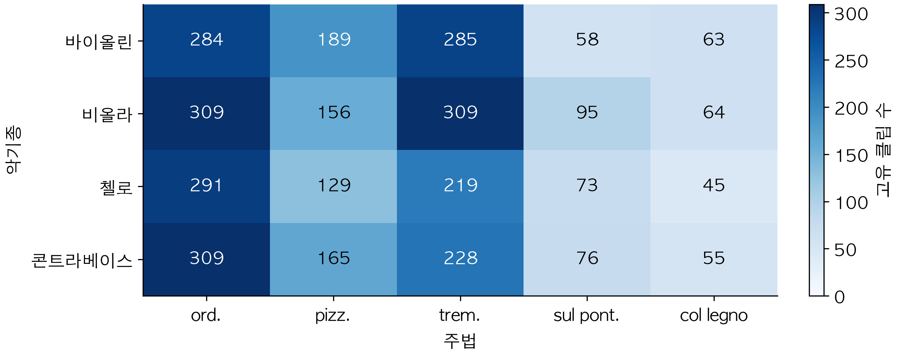
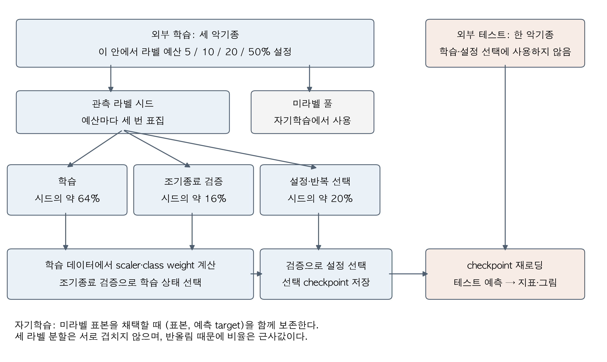
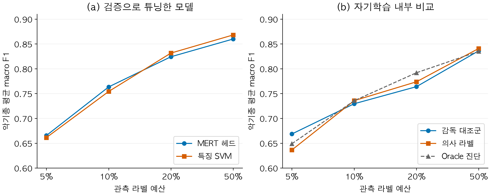
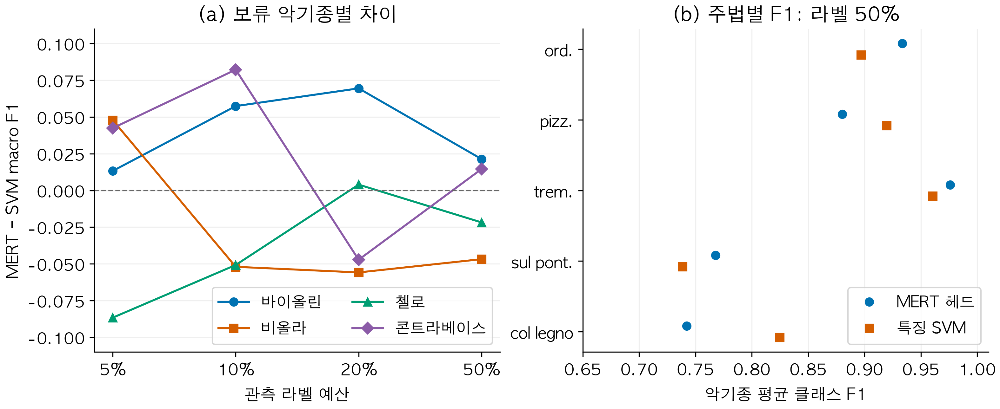
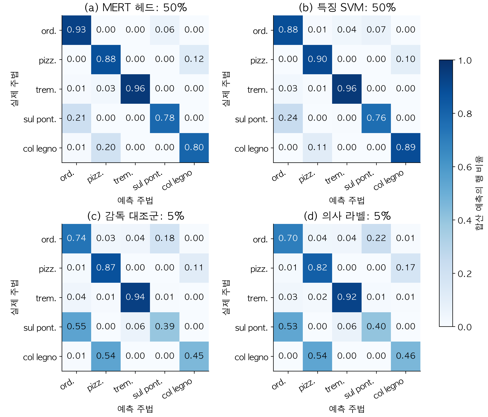
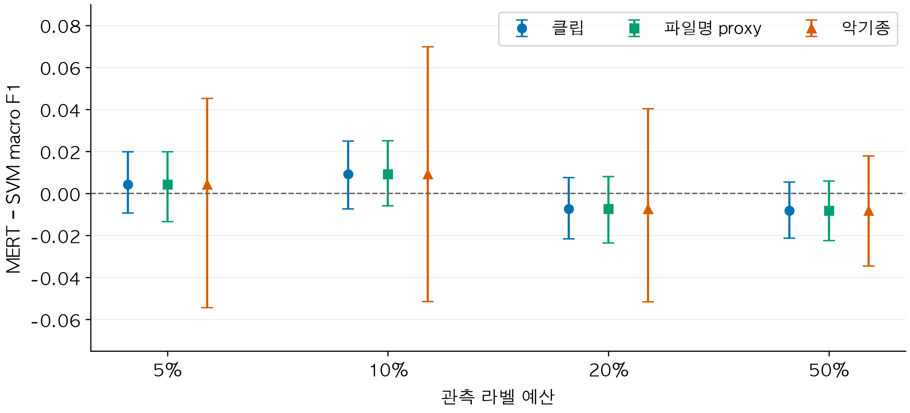

# 제한 라벨 조건의 현악 주법 분류: 악기종 보류 평가에서 음향 특징과 사전학습 표현의 비교

> 국문 전체 원고 v2 · 작성 2026-10-03, 내용 검토 2026-10-05 · 내부 검토본. 저자·소속 및 최종 저자 선언은 기입 전이다.

## 초록

현악 주법 분류에는 발음 방식과 음색의 차이를 구분하면서 악기종에 따른 변화를 다루는 능력이 필요하다. 음악 사전학습 표현의 활용 가능성을 판단하려면 제한된 라벨에서의 평균 성능뿐 아니라 악기종·주법별 오류와 평가 조건을 함께 살펴야 한다. 본 연구는 OrchideaSOL의 네 현악기종, 다섯 주법, 3,402개 클립에서 고정 MERT 표현 기반 분류 헤드와 245차원 음향 특징 기반 SVM을 비교한다. 한 악기종 전체를 테스트로 보류하고, 나머지 자료의 5%, 10%, 20%, 50%를 관측 라벨 예산으로 설정했다. 예산마다 세 번 표집하고 학습·조기종료·설정 선택용 라벨을 구분했다. MERT/SVM의 악기종 평균 macro F1은 각 예산에서 0.6655/0.6613, 0.7634/0.7542, 0.8242/0.8316, 0.8599/0.8681이었다. 평균 차이의 방향은 예산에 따라 달랐고, 같은 예산에서도 악기종과 주법에 따라 상대 성능이 달랐다. 별도로 설정을 맞춘 자기학습 비교에서는 5% 조건의 의사 라벨 학습이 감독 대조군보다 낮은 평균 F1을 보였으며, 나머지 예산에서는 소폭 높은 값을 보였다. 선택된 checkpoint와 저장 예측을 대조하고, 같은 예측에서 클립·파일명 기반 묶음·악기종 단위의 대응 재표집을 수행했다. 모든 MERT−SVM 차이 구간은 0을 포함했으며 이는 동등성의 증거로 해석하지 않았다. 본 연구는 제한 라벨의 악기종 보류 조건에서 두 분류 구성의 성능과 오류를 추적 가능한 자료로 제시하고, 결과의 적용 범위를 관찰한 네 악기종으로 한정한다.

**주제어:** 현악 주법 분류; 음향 특징; 음악 사전학습 표현; 제한 라벨; 자기학습; 악기종 보류 평가.

## 1. 서론

같은 현악기와 음고에서도 현을 지속적으로 긋는 소리, 손가락으로 뜯는 소리, 활의 나무 부분으로 두드리는 소리는 서로 다른 발음과 시간적 전개를 갖는다. 연주 주법은 악기 이름만으로 설명되지 않는 음색과 표현의 변화를 만든다. 따라서 오디오에서 주법을 구분하는 문제는 악기 인식보다 세밀한 수준의 음악 정보 분석과 연결된다. 선행 연구는 이러한 구분을 음색의 표현적 수준으로 다루고, 고립 음과 실제 연주 녹음에서의 주법 분류를 연구해 왔다(Su et al., 2014; Lostanlen et al., 2018). 주법별 음원 검색과 연주 분석은 가능한 활용 맥락이지만, 특정 분류기의 교육적 효과나 실제 연주 환경에서의 성능은 별도의 검증을 요구한다.

현악 주법의 차이는 하나의 음향 축으로 정리하기 어렵다. 현을 뜯거나 두드리는 동작은 발음의 시작과 감쇠에 차이를 만들 수 있고, 활을 접촉시키는 위치는 지속되는 소리의 음색에 영향을 줄 수 있다. 빠른 반복 활긋기는 시간적 변동을 만든다. 한편 같은 주법도 악기종의 음역과 공명 특성, 연주 강약, 녹음 조건에 따라 다른 신호로 나타날 수 있다. 주법을 분류하는 모델이 한 악기종에서 포착한 구분을 다른 악기종에도 적용할 수 있는지는 평균적인 음색 분류 성능과 구별해 살펴야 한다.

이 문제에 접근하는 한 방법은 음향 특징을 설계한 뒤 분류기를 학습하는 것이다. MFCC, 스펙트럼 대비, 에너지와 온셋 관련 통계량은 입력 신호의 특정 측면을 명시적으로 요약한다. 다른 방법은 대규모 음악 자료로 사전학습한 모델에서 표현을 추출하고, 목표 주법 라벨로 분류기를 학습하는 것이다. MERT는 음악 이해를 위한 사전학습 표현을 제공하는 대표적 사례다(Li et al., 2024). 그러나 사전학습 평가에서의 성과만으로 특정 주법 부분집합과 악기종 보류 조건에서의 이점을 미리 정할 수는 없다. 활용하는 층, 시간 집계, 분류 헤드와 라벨 예산을 구체화한 비교가 필요하다.

라벨 예산은 이 비교의 중요한 조건이다. 본 연구에서는 이미 라벨이 있는 데이터셋의 일부 라벨만 관측하는 상황을 구성한다. 관측한 라벨은 모델을 학습하는 데뿐 아니라 조기종료와 설정 선택에도 필요하다. 작은 예산에서 검증 라벨을 확보하면 실제 학습 표본은 더 줄어든다. 미라벨 표본에 모델의 예측을 붙여 다시 학습하는 자기학습은 이 제약을 완화할 가능성이 있지만, 선택한 의사 라벨의 오류와 클래스 분포에 영향을 받을 수 있다. 따라서 자기학습의 효과는 동일 조건의 감독 대조군과 비교해야 한다(Oliver et al., 2018).

본 연구의 핵심 질문은 다음과 같다. **라벨이 제한되고 주법 분류기 학습에서 보류한 악기종을 평가할 때, 특징 기반 SVM과 고정 MERT 표현 기반 분류기는 어떤 성능과 오류 양상을 보이는가?** 이를 위해 OrchideaSOL의 네 현악기종과 다섯 주법을 대상으로 악기종 보류 평가를 수행한다. 주요 비교는 관측 라벨 예산별 MERT 헤드와 SVM이다. 자기학습은 미라벨 자료 활용의 효과를 살펴보는 보조 비교로 둔다. 평균 성능에 더해 악기종별 차이, 클래스별 F1과 혼동행렬을 보고하여 전체 평균에서 가려지는 결과를 확인한다.

이 비교를 해석하려면 결과가 어떤 학습·선택 경로에서 나왔는지 확인해야 한다. 본 연구는 관측 라벨과 의사 target의 전달, 학습 분할에서 계산한 전처리 통계량, 검증으로 선택한 checkpoint, 저장 예측과 결과표를 연결한다. 과거 탐색 실행에서 확인한 구현 문제를 수정한 뒤 이 연결을 검증했다. 다만 여러 설정과 구현이 함께 달라졌으므로 과거 결과와의 차이를 개별 결함의 인과 효과로 제시하지 않는다. 또한 네 악기종의 관찰로 두 모델의 동등성이나 새로운 연주자 집단에 대한 일반화를 입증하지 않는다.

본 연구의 기여는 해당 조건에서 재계산할 수 있는 비교 관찰을 제공하는 데 있다. 첫째, 같은 관측 라벨 예산과 내부 학습 표본에서 비교한 MERT/SVM의 작은 평균 차이가 악기종·주법별 상대 성능 차이를 가린다는 것을 구체적인 점수와 오류 방향으로 제시한다(4.1–4.3절). 둘째, 동일 설정의 감독·의사 라벨·oracle 진단에서 자기학습의 변화가 라벨 예산에 따라 달랐음을 보고한다(4.4절). 셋째, checkpoint와 저장 예측을 연결하고 동일 예측의 재표집 민감도와 통계 재계산 경로를 제공해 앞의 관찰을 확인할 수 있게 한다(4.5절, 7절). 앞의 두 항목은 이 부분집합과 실행 정책의 경험적 결과이며, 세 번째는 이를 추적할 수 있는 연구 자료다. 새로운 분류 방법이나 일반적인 평가 이론을 제안하는 기여로 제시하지 않는다.

## 2. 관련 연구

### 2.1 현악 주법의 음향 특징과 분류

Su et al.(2014)은 활현악기의 주법 분류에서 크기 스펙트럼과 위상 유도 특징을 희소 모델링하는 접근을 연구했다. 고립 음의 분류와 실제 바이올린 연주 녹음을 함께 다루며, 특히 활의 접촉 위치처럼 미세한 주법 차이에 대한 음향 표현의 중요성을 논의했다. Kruger and Jacobs(2020)는 전통 음향 특징과 Hartley 변환 기반 특징을 SVM과 결합해 여러 현악기의 주법 및 악기·주법 공동 분류를 수행했다. 이들 연구는 특징 기반 분류를 비교 기준으로 삼을 근거를 제공한다. 다만 본 연구의 245차원 특징은 선행 연구의 특징을 그대로 재현한 것이 아니며, 데이터셋과 클래스 구성도 다르다.

주법의 시간적 구조를 표현하는 연구도 있다. Lostanlen et al.(2018)은 다양한 확장 주법을 포함한 자료에서 음향 표현과 검색·분류 문제를 다루었다. Ducher and Esling(2019)은 첼로 주법의 다차원적 구분과 Folded CQT 기반 모델을 제안하고, 사운드뱅크를 보류하는 평가를 사용했다. 이러한 연구는 주법 분류에서 시간·주파수 구조와 평가 자료의 출처를 함께 고려할 필요가 있음을 보여준다. 본 연구의 악기종 보류는 사운드뱅크 보류와 다른 평가 조건이므로, 어느 쪽이 일괄적으로 더 엄격하다고 서열화하지 않는다.

본 연구는 이 계보에서 다섯 주법의 클립 분류에 범위를 둔다. 프레임별 주법의 시작·종료를 검출하거나 복합 주법을 여러 속성으로 분해하는 과제는 수행하지 않는다. 선행 연구의 발표 수치도 데이터·분할·클래스가 다른 상태에서 본 연구의 점수와 직접 순위 비교하지 않는다. 관련 연구는 특징과 평가 설계의 선택을 설명하는 데 사용한다.

### 2.2 음악 사전학습 표현의 활용

MERT는 음향 및 음악 관련 학습 목표를 사용해 음악 오디오의 표현을 학습한다(Li et al., 2024). 사전학습 인코더를 고정하고 다운스트림 분류 구조를 학습하는 방식은 라벨이 적은 목표 과제에서 표현을 활용하는 한 방법이다. MERT 원논문은 단일 선형 분류기만을 표준으로 삼지 않으며 MLP 등의 다운스트림 구조와 검증 기반 탐색을 사용한다. 따라서 고정 표현의 성능은 표현 자체뿐 아니라 읽어내는 분류 구조와 선택 절차에도 영향을 받는다.

주법 인식에 직접 연결되는 선행 연구로 MERTech가 있다(D. Li et al., 2023). 이 연구는 MERT 기반 주법 검출에서 음고와 주법 시작점의 보조 과제를 이용한 다중 과제 미세조정을 다루며, 고정 MERT의 probing 조건도 비교한다. 평가는 고쟁·기타·중국 대나무 플루트의 프레임 및 이벤트 검출이다. 따라서 MERT를 주법 인식에 활용하는 것 자체를 본 연구의 신규성으로 삼을 수 없다. 본 연구는 고정된 마지막 층의 시간 평균을 사용하는 고립 음 분류에서, 네 현악기종의 보류와 관측 라벨 예산별 특징 SVM 비교를 다룬다는 범위 차이가 있다. 과제·자료·출력 단위가 달라 MERTech의 발표 점수와 직접 순위를 비교하지 않는다.

본 연구는 MERT-v1-95M의 마지막 층을 시간 평균한 표현을 사용하고, 선형 헤드와 MLP 헤드의 설정을 검증으로 선택한다. 이 구성과 특징 SVM을 비교한 결과는 실제로 실행한 두 분류 구성에 관한 것이다. 같은 분류기를 두 표현에 교차 적용한 실험이 아니므로 차이를 표현의 효과만으로 분리하지 않는다. 또한 층 가중 결합이나 인코더 미세조정의 모든 가능성을 포괄하지 않으며, 결과를 파운데이션 모델 전체의 성능 한계로 확대하지 않는다.

### 2.3 제한 라벨 평가와 결과의 타당성

Oliver et al.(2018)은 준지도학습을 평가할 때 감독 기준선, 관측·미관측 라벨의 양과 분포, 검증 조건을 고려해야 함을 논의했다. Musgrave et al.(2020)은 다른 분야의 사례이지만, 모델 비교에서 구현과 튜닝 조건이 보고되는 성능 차이에 영향을 줄 수 있음을 보여주었다. 본 연구에서는 두 비교 구성의 관측 라벨과 내부 학습 index를 맞추고, 설정 선택에 테스트 예측을 사용하지 않는다. 다만 탐색 횟수와 계산량이 같지는 않으므로 이를 모든 자원이 동등한 비교라고 부르지 않는다.

누수와 교란에 대한 문헌은 결과의 출처를 확인하는 기준을 제공한다. Kapoor and Narayanan(2023)은 기계학습 기반 과학에서 데이터 누수와 재현성 문제를 검토했다. Rodríguez-Algarra et al.(2019)은 음악 분류에서 여러 요인의 영향을 구분하기 위한 통제된 개입을 다루었다. 이에 비추어 본 연구는 구현 경계를 검증하되, 동시에 바뀐 여러 요소의 효과를 단일 원인으로 해석하지 않는다. 재표집 단위를 바꿔 얻은 구간도 고정된 예측에 조건부인 민감도 결과로 보고한다. 이 문헌 고찰은 본 과제와 방법을 연결하기 위한 것이며, 분야 전체에서 최초라는 주장을 입증하는 체계적 문헌 고찰은 아니다.

## 3. 데이터와 방법

### 3.1 자료와 다섯 주법

OrchideaSOL은 고립된 악기음을 포함하는 자료이며 주법 인식 등의 연구에 사용하도록 공개된 메타데이터와 분할을 제공한다(Cella et al., 2020). 본 연구는 로컬 자료의 Violin, Viola, Violoncello, Contrabass 폴더에서 표 1의 다섯 주법을 선택했다. 별도 뮤트 폴더나 다른 주법을 이 부분집합에 추가하지 않았고, 클래스별 다운샘플링도 하지 않았다. 최종 부분집합은 3,402개 클립이다. 라벨은 자료의 주법 분류를 사용했으며 이번 연구에서 독립적인 청취자 재주석을 수행하지 않았다.

Table: 표 1. 분석 대상 주법과 표본 수. 연주 방식은 클래스의 의미를 설명하며 모델이 해당 단서를 실제 사용했다는 주장과 구별한다.

| 주법 | 연주 방식의 요약 | 클립 수 |
|---|---|---:|
| ordinario | 통상적인 활긋기 | 1,193 |
| pizzicato secco | 손가락으로 뜯는 짧고 건조한 피치카토 | 639 |
| tremolo | 활긋기를 빠르게 반복하는 트레몰로 | 1,041 |
| sul ponticello | 브리지 가까이에서 활을 긋는 주법 | 302 |
| col legno battuto | 활의 나무 부분으로 현을 두드리는 주법 | 227 |
| 합계 | 네 악기종의 고립 음 | 3,402 |

악기종별 표본은 바이올린 879개, 비올라 933개, 첼로 757개, 콘트라베이스 833개다. 그림 1은 주법과 악기종의 교차 분포를 보여준다. 모든 악기종에 다섯 클래스가 존재하지만 표본 수는 같지 않다. 특히 sul ponticello와 col legno battuto의 표본이 적다. 이 불균형 때문에 전체 정확도만으로 성능을 요약하지 않고 클래스별 F1의 평균인 macro F1을 주요 지표로 사용한다.

{width=100%}

공식 OrchideaSOL은 악기·음고·강약을 고려한 5분할을 제공한다. 본 연구의 질문은 학습에서 제외한 악기종을 분류할 수 있는지에 있으므로 자체적인 악기종 보류 4분할을 사용했다. 따라서 본 결과를 공식 분할의 벤치마크 점수로 제시하지 않는다. 공식 메타데이터 설명에는 일부 음원의 조율·음고 변환이 포함되어 있다. 본 연구는 파일명에서 만든 묶음을 기록하지만, 원 녹음의 계보나 연주자·세션을 독립적으로 확인하지 않았다. 이 한계는 5.4절에서 논의한다.

### 3.2 외부 평가와 관측 라벨 예산

외부 평가는 한 악기종 전체를 테스트로 보류하고 나머지 세 악기종을 학습·검증 후보로 두는 네 fold로 구성한다. 그룹 키는 악기종이다. 각 외부 학습 후보에서 클래스별로 관측 라벨 시드를 표집하여 5%, 10%, 20%, 50%의 예산을 만든다. 나머지 표본은 미라벨 풀로 둔다. 예산마다 세 번 표집하므로 예산당 12개, 전체 48개 분할이 있다. 세 반복은 동일 악기종 테스트 클립을 사용하며, 독립적인 세 테스트 데이터셋을 의미하지 않는다.

관측 라벨 시드의 약 20%는 설정 선택용 검증에 배정한다. 남은 약 80%를 다시 학습 80%와 조기종료 검증 20%로 나눈다. 따라서 시드 전체를 기준으로 직접 학습·조기종료·설정 선택에 약 64%·16%·20%가 사용된다. 분할은 클래스별로 수행하고 최소 검증 표본 및 반올림 때문에 실제 비율은 근사값이다. 세 라벨 분할과 외부 테스트는 서로 겹치지 않는다. MERT/SVM의 주 비교에서는 SVM도 동일한 직접 학습 index를 사용한다. 조기종료가 없는 SVM에 조기종료용 표본을 추가해 학습시키지 않는다.

5% 예산에서는 MERT/SVM의 직접 학습 표본이 fold에 따라 78–85개, 조기종료 검증은 20–21개, 설정 선택 검증은 25–26개다. 즉 ‘5% 라벨 학습’이라는 표현에는 학습 외의 검증에 배정한 관측 라벨도 포함된다. 예산별 실제 범위는 부록 B에 제시한다. 이러한 작은 검증셋은 경계를 유지하면서도 설정 선택의 변동 가능성을 남긴다. 본 연구의 예산 비교는 이 검증 정책을 포함한 실행 조건에 관한 것이다.

{width=100%}

### 3.3 음향 특징과 MERT 표현

특징 기반 구성은 모노 22,050 Hz 오디오에서 245차원의 통계적 음향 특징을 계산한다. 프레임별 다차원 특징에는 채널마다 평균, 표준편차, 25백분위수, 75백분위수를 적용하여 클립을 고정 길이 벡터로 만든다. 표 2는 특징군과 차원을 보여준다. 클래스 라벨이나 테스트 분포를 사용하지 않는 클립별 특징 계산과, 학습 표본에서 적합하는 표준화는 구별한다. SVM 입력의 표준화 평균과 분산은 각 실행의 직접 학습 표본에서만 구한다.

Table: 표 2. 특징 SVM의 입력 구성. 통계량 네 개는 클립의 시간 프레임을 집계한다.

| 특징군 | 채널과 집계 | 차원 |
|---|---|---:|
| MFCC 및 1·2차 delta | 13채널 × 3종 × 4통계량 | 156 |
| Spectral contrast | 7채널 × 4통계량 | 28 |
| Onset-strength envelope | 1채널 × 4통계량 | 4 |
| Zero-crossing rate | 1채널 × 4통계량 | 4 |
| RMS energy | 1채널 × 4통계량 | 4 |
| Chroma | 12채널 × 4통계량 | 48 |
| 첫 검출 onset 시각의 log1p | 클립당 1개 | 1 |
| 합계 | | 245 |

코드에서 `flux`로 시작하는 컬럼은 librosa의 onset-strength envelope를 집계한 것이다. 프레임 간 mel 스펙트럼의 양의 변화에 기반한 onset strength와 일반적인 spectral flux 용어를 혼용하지 않도록 이 원고에서는 전자의 이름을 사용한다. 마지막 한 차원도 onset에서 최대 진폭까지의 상승시간이 아니라 첫 검출 onset의 시각에 log1p를 적용한 값이다. Chroma는 입력에 유지하며, 이번 canonical 비교에는 제거 실험이 없으므로 그 기여가 없다고 결론내리지 않는다.

MERT 구성은 `m-a-p/MERT-v1-95M` 인코더에 모노 24,000 Hz 오디오를 입력하고, 마지막 hidden layer의 시간 프레임을 평균해 768차원 벡터를 얻는다. 인코더의 가중치는 고정하고 분류 헤드만 학습한다. 사전학습에 사용된 외부 자료와 계산 자원은 본 연구의 관측 라벨 예산에 포함되지 않는다. 두 입력 구성은 오디오를 클립 단위로 집계한다는 공통점이 있지만, 서로 다른 변환과 분류기를 사용한다. 어느 표현이 주법의 특정 물리적 단서를 더 잘 보존하는지까지 이 성능 비교만으로 분리해서 판단할 수는 없다.

### 3.4 학습과 검증 기반 선택

MERT 헤드는 LayerNorm과 dropout을 포함하는 선형 출력 구조 또는 은닉 256차원의 MLP를 사용한다. MLP는 ReLU와 추가 dropout을 사용한다. 각 설정은 가중 교차엔트로피와 AdamW로 학습하며, class weight는 직접 학습 표본의 클래스 빈도에서 계산한다. 조기종료 검증의 macro F1으로 해당 설정의 학습 상태를 고르고, 설정 선택용 검증의 macro F1으로 최종 설정을 선택한다. 동률은 고정된 탐색 순서로 처리한다.

SVM은 RBF 커널을 사용하며 StandardScaler와 SVC를 하나의 학습 파이프라인으로 적합한다. 표준화와 균형 class weight는 학습 index에서만 구한다. MERT와 같은 설정 선택 검증에서 C와 γ를 고른다. 표 3은 주요 탐색 범위를 정리한다. 두 모델에 검증 분리를 적용한 것은 테스트 기반 선택을 막기 위한 조건이며, 24개와 12개라는 설정 수가 동등 계산 예산이나 각 계열의 최적화를 보장하지는 않는다.

Table: 표 3. MERT/SVM 주 비교와 자기학습의 학습 설정.

| 구성 | 학습·탐색 설정 | 선택 기준 |
|---|---|---|
| MERT 헤드 | 선형/MLP-256; 학습률 0.0003/0.001/0.003; weight decay 0.0001/0.001; dropout 0.1/0.3; 총 24설정 | 설정별 조기종료 후 별도 검증 F1 |
| MERT 헤드 학습 | 전체 학습 배치 AdamW; 최대 200 epoch; patience 20 | 조기종료 검증 F1 |
| 특징 SVM | RBF; C=0.1/1/10/100; γ=scale/0.01/0.001; 총 12설정 | 같은 설정 선택 검증 F1 |
| 자기학습 헤드 | LayerNorm–dropout(0.3)–linear; AdamW; 학습률 0.001; weight decay 0.0001 | 반복별 조기종료 후 관측 라벨 검증 F1 |
| 자기학습 반복 | 적합당 최대 150 epoch; patience 15; τ=0.8; 최대 5회 적합 | 고정된 관측 라벨 검증에서 반복 선택 |

최종 설정을 고른 뒤 선택된 MERT와 SVM의 checkpoint를 저장하고 다시 불러와 테스트 예측을 계산한다. 선택 과정에 테스트 F1을 입력하지 않는다. 이후의 재검증은 선택된 파일에서 예측을 재생성하는 절차이며, 새 설정을 선택하기 위한 테스트 조회와 구별한다. 재로딩 후의 예측, 테스트 index, 모델 파일의 해시와 지표를 실행별 manifest로 연결했다.

### 3.5 자기학습과 oracle 진단

자기학습 비교는 별도의 고정 헤드 설정에서 감독학습, 의사 라벨 학습, oracle 진단의 세 조건을 실행한다. 세 조건은 관측 라벨 시드, 내부 학습·검증 분할과 무작위 시드 및 선택 규칙을 공유한다. 감독 대조군은 관측 라벨로 한 번 적합한다. 의사 라벨 조건은 현재 모델이 미라벨 풀에 부여한 최대 클래스 확률이 τ=0.8 이상인 표본을 채택하고, 그때의 예측 클래스를 이후 학습 target으로 보존한다. 채택한 표본은 미라벨 풀에서 제거하며, 조기종료·설정 선택 검증 표본을 의사 라벨 풀에 넣지 않는다.

반복마다 모델을 해당 시드와 누적 학습 풀로 새로 적합하고, class weight도 그 풀의 명시적 target에서 다시 계산한다. 최대 다섯 회의 모델 적합을 수행하며, 마지막 적합 뒤에는 새 표본을 추가하지 않는다. 채택할 표본이나 남은 풀이 없으면 먼저 종료한다. 최종 반복은 고정된 관측 라벨 검증의 F1으로 고른다. 따라서 ‘다섯 반복’은 항상 다섯 번의 의사 라벨 추가를 의미하지 않는다. 초기 감독 상태도 선택 후보에 포함된다.

과거 구현에는 의사 라벨로 채택한 표본 index를 늘린 뒤 전체 정답 배열에서 target을 다시 읽는 문제가 있었다. 수정 경로는 학습 풀을 `(표본 index, target)` 쌍으로 유지하고 실제 의사 target을 전달한다. 매 반복의 채택 index·target과 학습 풀의 해시를 저장해 이 경로를 확인했다. 과거 자기학습 점수는 이러한 경계와 학습 설정이 현재와 달랐으므로, 본 원고의 전후 인과 효과 계산에 사용하지 않는다.

Oracle 조건에서는 채택한 미라벨 표본의 숨은 정답을 명시적으로 제공한다. 이는 그 정보에 접근하는 별도의 진단 조건이며 실제 미라벨 학습으로 제시하지 않는다. 이후 모델과 채택 표본이 달라질 수 있고 최종 상태는 검증으로 선택되므로, 이 절차가 의사 라벨 조건보다 항상 높은 테스트 성능을 보장하지도 않는다. Oracle의 낮은 성능을 특정 원인의 효과로 확정하지 않는다.

자기학습의 감독 대조군은 3.4절의 튜닝 MERT와 헤드·내부 분할 시드·학습 설정이 다르다. 자기학습 효과는 세 조건 내부에서 비교하며, 두 실험의 감독 점수를 서로 교환하지 않는다. 자기학습의 미라벨 풀은 외부 학습에 속한 세 악기종에서 나오므로, 보류 테스트 악기종의 음원을 이용하는 전이적 학습도 아니다.

### 3.6 평가 지표와 집계

주요 지표는 다섯 클래스의 F1을 같은 비중으로 평균한 macro F1이다. 클래스 $c$의 참양성·거짓양성·거짓음성을 각각 $TP_c$, $FP_c$, $FN_c$라 할 때 다음과 같이 계산한다.

$$F1_c=\frac{2TP_c}{2TP_c+FP_c+FN_c},\qquad F_{\mathrm{macro}}=\frac{1}{5}\sum_{c=1}^{5}F1_c.$$

분모가 0인 경우의 점수는 0으로 처리한다. 각 모델 $m$, 예산 $r$, 악기종 fold $g$, 반복 $t$에서 얻은 macro F1을 $F_{m,r,g,t}$라 하면 보고하는 평균은 다음과 같다.

$$\bar F_{m,r}=\frac{1}{4}\sum_{g=1}^{4}\left(\frac{1}{3}\sum_{t=1}^{3}F_{m,r,g,t}\right).$$

클래스별 F1도 같은 순서로 평균한다. 이 방식은 표본 수가 많은 악기종에 더 큰 비중을 주지 않는다. 반면 혼동행렬은 네 fold의 세 반복 예측을 합친 뒤 실제 클래스 행별로 정규화한다. 예산·모델별로 고유 클립 3,402개에 대한 세 번의 예측, 즉 10,206개의 예측 사건이 들어간다. 따라서 혼동행렬의 대각선은 합산 예측의 클래스 재현율이며, 표의 악기종 평균 클래스 F1과 같은 통계량이 아니다.

### 3.7 재표집 민감도와 결과 출처

MERT−SVM 차이에 대해 고정 예측에서 1,000회 대응 percentile 재표집을 수행한다. 클립 단위에서는 각 악기종 안의 테스트 위치를 복원추출하고, 같은 위치를 두 모델과 해당 악기종의 세 반복에 공통으로 적용한다. 파일명 proxy 단위에서는 악기 약칭·음고·강약에서 유도한 묶음을 복원추출한다. 악기종 단위에서는 클립 예측을 고정한 채 네 악기종의 점수를 복원추출한다. 각 방식의 점추정 집계는 3.6절과 일치하며, 2.5·97.5백분위수를 구간으로 표시한다.

세 방식은 변동시키는 요소가 다르다. 특히 악기종 단위의 재표집은 네 관찰 종류를 다시 조합하는 계산이다. 네 fold가 겹치는 학습 자료를 사용하고, 새로운 연주자나 세션을 표집한 설계도 아니므로 더 넓은 모집단의 불확실성을 포괄한다고 보지 않는다. 파일명 proxy 역시 검증된 독립 녹음 세션 ID가 아니다. 이번 분석은 단위 선택에 따른 민감도를 보여주며, 학습 시드·하이퍼파라미터 선택을 매번 다시 수행하는 재학습 bootstrap은 아니다.

결과 출처 검증은 MERT/SVM 48쌍과 CNN 네 fold의 checkpoint 100개, 자기학습 세 조건의 checkpoint 144개를 재로딩해 저장 예측과 대조하는 방식으로 수행됐다. 자기학습은 반복별 index와 target으로 학습 풀을 복원해 해시를 확인했다. 본문 수치와 그림은 이 검증을 통과한 저장 예측에서 파생된 CSV를 사용한다. 저장 예측만으로 표를 재계산하는 별도 실행 경로는 7절에 기술한다.

## 4. 결과

### 4.1 관측 라벨 예산에 따른 평균 성능

표 4는 MERT/SVM 주 비교를 보여준다. 두 구성 모두 관측 라벨 예산이 커질수록 평균 macro F1이 높아졌다. MERT는 5%의 0.6655에서 50%의 0.8599로, SVM은 0.6613에서 0.8681로 높아졌다. 같은 예산의 평균 차이는 절댓값 0.01보다 작았으나 방향은 일정하지 않았다. 5%와 10%에서는 MERT가, 20%와 50%에서는 SVM이 높은 점추정을 보였다. 이 결과에서 모든 예산에 걸쳐 우세한 한 모델을 정할 수는 없다.

Table: 표 4. 제한 라벨 주 비교. 점수는 악기종 안의 세 반복을 평균한 뒤 네 악기종을 같은 비중으로 평균했다. 구간은 고정 예측의 악기종 재표집 민감도이며 모델 동등성 검정이 아니다.

| 관측 라벨 | MERT 헤드 | 특징 SVM | MERT−SVM | 차이의 95% 재표집 구간 |
|---:|---:|---:|---:|---:|
| 5% | 0.6655 | 0.6613 | +0.0042 | [−0.0544, +0.0451] |
| 10% | 0.7634 | 0.7542 | +0.0092 | [−0.0514, +0.0698] |
| 20% | 0.8242 | 0.8316 | −0.0074 | [−0.0515, +0.0403] |
| 50% | 0.8599 | 0.8681 | −0.0082 | [−0.0345, +0.0179] |

그림 3(a)는 예산에 따른 두 평균의 변화를 보여준다. 예산 증가는 직접 학습 라벨뿐 아니라 검증에 사용하는 라벨도 늘리는 정책이다. 따라서 곡선의 상승을 직접 학습 표본 증가 하나의 효과로 분리하지 않는다. 또한 각 예산에서 클래스별로 표집한 시드는 반드시 포함 관계가 되도록 구성한 것이 아니므로, 선분은 네 평가 조건을 연결해 읽기 쉽게 한 것이다.

{width=100%}

### 4.2 악기종과 주법별 성능 차이

전체 평균의 작은 차이는 모든 악기종에서 비슷한 점수를 얻었다는 뜻이 아니다. 그림 4(a)의 50% 조건에서 MERT−SVM 차이는 바이올린 +0.0213, 비올라 −0.0468, 첼로 −0.0218, 콘트라베이스 +0.0146이었다. 예산을 바꾸면 같은 악기종에서도 방향이 바뀌었다. 예를 들어 비올라에서는 5%에 MERT가 높았지만 나머지 예산에서는 SVM이 높았다. 이러한 결과는 평균 차이를 특정 악기종의 성능으로 대신 읽을 수 없음을 보여준다. 각 점은 세 번의 관측 라벨 표집에 대한 평균이며 독립적인 악기 개체 세 개의 평균이 아니다.

주법별 차이도 존재한다. 50% 조건에서 MERT의 클래스 F1은 ordinario 0.9334, pizzicato secco 0.8801, tremolo 0.9760, sul ponticello 0.7678, col legno battuto 0.7423이었다. SVM의 대응 값은 0.8969, 0.9197, 0.9606, 0.7386, 0.8248이었다. 두 모델 모두 tremolo에서 높은 값을 보였으나, 상대적인 강점은 클래스마다 달랐다. 특히 col legno battuto에서는 SVM의 F1이 높았고, sul ponticello에서는 MERT가 높았다. 표본 수가 적은 이 두 클래스에서도 상대 순위는 반대였다. 빈도와 음향적 난도의 영향은 이 비교에서 분리하지 않았다.

{width=100%}

### 4.3 클래스 혼동의 구조

그림 5(a,b)는 50% 조건의 혼동행렬이다. 두 모델에서 sul ponticello가 ordinario로 분류되는 비율은 합산 예측 기준 약 0.21과 0.24였다. 역방향인 ordinario에서 sul ponticello로의 혼동은 약 0.06과 0.07이었다. 따라서 두 클래스 사이의 혼동은 대칭적이지 않다. 또 col legno battuto가 pizzicato secco로 분류되는 비율은 MERT 약 0.20, SVM 약 0.11이었고, 역방향 비율은 각각 약 0.12와 0.10이었다. 단순히 두 클래스가 서로 가깝다고 요약하기보다 어느 방향의 오류가 많은지 구분할 필요가 있다.

이 행렬은 4.2절의 F1 차이를 읽는 데 도움을 주지만 동일 통계량을 재표현한 것은 아니다. 예를 들어 클래스 F1은 재현율뿐 아니라 다른 클래스에서 유입되는 거짓양성에도 영향을 받는다. 또한 행렬은 전체 예측을 합산하지만 표의 F1은 악기종별 점수를 같은 비중으로 평균한다. 그 결과 행렬 대각선이 높아진 정도와 평균 F1 변화가 그대로 일치하지 않을 수 있다. 본문에서는 이 두 집계 수준을 구별한다.

{width=100%}

### 4.4 자기학습의 결과

표 5와 그림 3(b)는 설정을 맞춘 세 자기학습 조건을 비교한다. 5%에서 의사 라벨 조건은 감독 대조군보다 macro F1이 0.0322 낮았다. 10%, 20%, 50%에서는 각각 0.0062, 0.0098, 0.0047 높았다. 따라서 이 임계값과 헤드·선택 절차에서 관측 라벨 전 구간에 걸친 일관된 개선을 관찰하지 못했다. 이 차이에 대해 별도의 대응 불확실성 검정을 수행하지 않았으므로 소폭 높은 점추정을 통계적으로 확정된 개선으로 부르지 않는다.

Table: 표 5. 같은 분할·시드·설정에서의 자기학습 비교. Oracle은 채택 표본의 숨은 정답을 사용하는 진단이며 실제 준지도학습 방법이나 성능 상한이 아니다.

| 관측 라벨 | 감독 대조군 | 의사 라벨 | 의사 라벨−감독 | Oracle 진단 |
|---:|---:|---:|---:|---:|
| 5% | 0.6686 | 0.6364 | −0.0322 | 0.6489 |
| 10% | 0.7295 | 0.7357 | +0.0062 | 0.7356 |
| 20% | 0.7639 | 0.7737 | +0.0098 | 0.7919 |
| 50% | 0.8361 | 0.8409 | +0.0047 | 0.8350 |

5% 의사 라벨 조건의 클래스별 F1은 sul ponticello 0.3324와 col legno battuto 0.4237로 낮았다. 그림 5(c,d)에서도 이 두 실제 클래스가 각각 ordinario와 pizzicato secco로 분류되는 경우가 많다. 같은 조건의 의사 라벨−감독 클래스 F1 차이는 ordinario −0.0242, pizzicato secco −0.0502, tremolo −0.0118, sul ponticello −0.0381, col legno battuto −0.0367로 다섯 클래스 모두 음수였다. 가장 큰 F1 하락은 pizzicato secco에서 관찰됐다. 따라서 평균 하락이 두 소수 클래스에만 집중됐다고 요약할 수 없다. 다만 의사 라벨 적용 뒤 두 소수 클래스의 행렬 대각선이 모두 낮아지는 것은 아니다. 전체 F1의 하락을 두 클래스의 재현율 감소만으로 설명할 수 없으며, 거짓양성의 변화와 악기종별 평균도 함께 고려해야 한다.

Oracle은 모든 예산에서 가장 높지 않았다. 5%에서는 감독 대조군보다 낮았고, 50%에서는 의사 라벨 조건보다 낮았다. 이 관찰은 숨은 정답을 제공하면 반드시 최고 성능을 얻는다는 진단 해석을 배제한다. 그러나 정답 제공 자체가 성능을 악화시킨다고 결론낼 근거도 아니다. 모델 적합, 후속 채택과 검증 선택이 연결된 절차이며, 요인별 통제 실험을 수행하지 않았기 때문이다.

### 4.5 재표집 단위에 따른 민감도

그림 6은 같은 저장 예측에서 MERT−SVM 차이를 재표집한 결과다. 네 예산에서 클립·파일명 proxy·악기종의 세 단위 모두 구간에 0을 포함했다. 악기종 구간은 클립·proxy 구간보다 넓었다. 예를 들어 50%의 차이 −0.0082에 대한 구간은 클립 [−0.0212, +0.0054], proxy [−0.0224, +0.0059], 악기종 [−0.0345, +0.0179]였다. 세 구간은 같은 점추정에 붙지만 서로 다른 변동을 반영한다.

{width=100%}

현재 예측에서는 재표집 단위를 바꾸어 차이의 부호에 대한 구간 판정이 뒤집히지 않았다. 따라서 과거의 다른 예측에 붙은 구간과 이번 표를 결합해 ‘재표집 단위 때문에 승패가 뒤집혔다’고 기술하지 않는다. 또한 구간이 0을 포함한다는 사실은 실질적 차이가 작다는 것을 충분한 정밀도로 입증한 것과 다르다. 본 연구에는 사전에 정한 동등성 허용 격차와 이를 평가할 독립 그룹 설계가 없다.

## 5. 논의와 한계

### 5.1 평균 순위와 조건별 성능을 함께 읽기

본 연구에서 두 분류 구성의 평균은 라벨 예산 증가와 함께 높아졌고, 같은 예산의 평균 차이는 작았다. 그러나 상대 성능의 방향은 예산·악기종·주법에 따라 달랐다. 이 결과가 제공하는 실질적인 정보는 하나의 모델을 모든 조건의 기본 선택으로 정하기 어렵다는 점이다. 적용 대상에서 중요한 주법과 학습 라벨의 양을 정한 뒤 해당 조건의 성능을 살펴볼 필요가 있다. 다만 네 악기종에 한정된 결과이므로 다른 자료에서 같은 선택이 최선이라고 보장하지는 않는다.

평균 macro F1은 소수 클래스의 성능을 반영하지만 클래스별 목적을 모두 대신할 수 없다. 예를 들어 col legno battuto의 검출을 중요하게 여기는 활용에서는 해당 클래스의 거짓음성과 거짓양성을 함께 살펴야 한다. 반대로 평균이 높은 모델이라도 특정 악기종에서 상대적으로 낮은 값을 보일 수 있다. 그림 4와 그림 5를 평균 곡선과 함께 제시한 이유는 이러한 차이를 드러내기 위해서다. 별도의 응용 비용을 정하지 않았으므로 특정 오류가 다른 오류보다 더 큰 손실을 만든다는 정량적 판단은 하지 않는다.

두 모델이 같은 라벨 표본을 사용했다는 조건에도 범위가 있다. SVM과 MERT는 입력 표현뿐 아니라 분류기, 사전학습 경험과 계산량이 다르다. 따라서 이 연구는 두 사용 가능한 구성의 비교이며 표현 차원이나 모델 규모만의 효과를 추정한 실험이 아니다. 처리 시간·메모리·추출 비용을 같은 장치에서 비교하지 않았으므로 특징 모델의 비용 우위까지 실측 결론으로 붙이지 않는다.

### 5.2 오류 패턴의 음악적 의미

주법의 정의와 관찰한 오류를 연결하면 두 종류의 구분을 살펴볼 수 있다. Ducher and Esling(2019)의 다차원 분류는 가진 수단, 시간적 상호작용과 접촉 위치 등을 구별하며, Su et al.(2014)은 활의 접촉 위치 차이에 대한 음향 표현을 논의했다. 이 문헌은 클래스의 의미를 설명하는 근거이며 본 모델의 사용 단서를 검증하는 근거는 아니다.

첫째, 지속적인 활긋기에서 접촉 위치가 다른 ordinario와 sul ponticello의 구분이다. 50% 조건에서 sul ponticello→ordinario의 합산 혼동 비율은 MERT/SVM 약 0.21/0.24로 역방향 0.06/0.07보다 높았다(4.3절). 이는 현재 분류기의 오류가 sul ponticello를 ordinario로 읽는 방향에 더 많았다는 관찰이다. 해당 비대칭이 음색 차이의 부족, 표본 불균형 또는 특정 특징의 손실에서 비롯됐는지는 확인하지 않았다. 둘째, 손가락으로 뜯는 pizzicato secco와 활의 나무 부분으로 두드리는 col legno battuto의 구분이다. Col legno battuto→pizzicato secco의 혼동은 MERT/SVM 약 0.20/0.11이었다. 발음 시작과 감쇠의 유사성이 가능한 설명이지만, 본 자료의 그 유사성을 청취나 음향 측정으로 검증하지 않았다. Tremolo의 높은 F1 역시 반복 활긋기와 관련된 단서를 이용했을 가능성과 연결할 수 있으나, 반복성 자체의 효과를 입증한 결과는 아니다.

본 실험의 특징 입력은 프레임별 통계량을 클립 전체에 걸쳐 집계하고, MERT도 시간 평균을 사용한다. 이 집계는 분류 헤드에 프레임별 순서를 명시적으로 전달하지 않는다. 그러나 특징에는 MFCC의 시간 차분이 포함되고 MERT는 평균 이전에 문맥을 반영한 프레임 표현을 계산하므로, 시간 평균을 사용했다는 사실만으로 시간 정보가 전혀 없다고 볼 수는 없다. 남아 있는 통계적·문맥적 단서가 일부 주법을 구분하는 데 유용했을 가능성은 있지만, 시간 평균 때문에 특정 오류가 발생했다거나 온셋 단서만으로 높은 성능이 설명된다는 주장은 별도의 개입·제거 실험이 필요하다. 입력 변환을 바꾼 대조 실험 없이 이번 혼동행렬을 그 증거로 사용할 수는 없다.

또한 빈도가 낮은 두 클래스에서 성능이 낮게 나타나는 경우가 있지만, 표본 부족과 음향적 난도를 분리하지 못했다. 클래스마다 표본 수를 맞춘 실험이나 데이터 증가 실험을 수행하지 않았고, 라벨의 청취자 간 일치도도 측정하지 않았다. 따라서 ‘음악적으로 본질적으로 구분하기 어렵다’와 ‘현재 학습 조건에서 오류가 많다’를 구별해야 한다. 현 단계에서 확인한 것은 후자다.

과거 탐색의 SHAP과 층별 서술자 프로브는 현재 결과의 기전을 확정하는 근거로 포함하지 않았다. 해당 SHAP은 별도 XGBoost를 설명하며 현재 canonical MERT 헤드나 SVM의 결정을 직접 설명하지 않는다. 층별 표현에서 어떤 서술자를 복원할 수 있다는 사실도 주법 분류기가 그 정보를 실제로 사용했다는 사실과 같지 않다. 따라서 v2의 음악적 해석은 검증된 오류 패턴과 문헌상 주법의 의미에 근거하고, 모델 내부의 원인은 미확인으로 남긴다.

### 5.3 자기학습에서 확인한 것과 남은 설명

의사 라벨 학습은 미라벨 자료를 추가로 사용하지만, 추가 표본이 곧 유효한 학습 정보 증가를 보장하지 않는다. 본 설정에서 5% 조건은 감독 대조군보다 낮았고, 다른 예산의 차이는 소폭 양수였다. 이 양상은 라벨이 가장 적은 조건에서 자기학습의 효용을 특히 신중히 판단해야 함을 보여준다. 다만 임계값·확률 보정·증강·다른 준지도학습 방법을 비교한 결과가 아니므로 자기학습 전반에 대한 부정적 결론은 아니다.

최대 예측 확률을 신뢰도로 사용하는 것도 제한이 있다. 이번 실험은 확률 보정을 수행하지 않았으므로 τ=0.8을 ‘정답일 확률 80%가 검증된 표본’이라는 의미로 읽을 수 없다. 채택 클래스의 불균형, 오류 target의 누적, 학습 풀 변화와 class weight 재계산은 가능한 영향 요인이다. 저장 기록은 무엇이 채택되고 어떤 target이 전달됐는지 추적하게 하지만, 각 요인의 기여를 자동으로 분리하지는 않는다. 따라서 오류 누적 하나를 관찰된 평균 하락의 확정 원인으로 제시하지 않는다.

감독 대조군이 자기학습의 초기 상태와 설정을 공유하고, 검증이 초기 상태를 선택할 수 있도록 한 것은 유용한 기준이다. 그럼에도 검증에서 선택한 상태가 모든 테스트 악기종에서 최선이 되지는 않는다. 특히 관측 라벨과 선택 검증이 작을 때의 변동 가능성이 남는다. 이를 검토하려면 별도 통제 분석이 필요하며, 현재 원고에서는 결과의 조건으로 명시한다.

### 5.4 일반화와 불확실성의 범위

악기종 보류는 동일 악기종이 외부 학습과 테스트에 동시에 포함되는 것을 막는다. 그러나 악기종과 실제 악기 개체, 연주자, 녹음 세션은 다른 단위다. 현재 자료에서 뒤의 식별자들을 검증하지 않았으므로 새로운 연주자·세션의 독립 평가로 제시할 수 없다. 데이터셋의 공통 녹음 환경, 음역과 강약 분포, 디지털 변환의 영향도 분리하지 않았다. 파일명 proxy를 독립 녹음의 증거로 대체하지 않는 이유가 여기에 있다.

또한 악기종 보류는 본 연구의 주법 분류기 학습에 적용한 경계다. MERT 사전학습 자료에 해당 음원이나 관련 녹음이 포함됐는지는 이번 감사에서 확인하지 않았다. 따라서 사전학습까지 포함해 완전히 미관측인 음원을 평가했다고 보장하지 않는다.

클립 수는 3,402개이지만 악기종 수준의 관찰은 네 종류다. 세 번의 라벨 표집과 bootstrap 반복 횟수는 이 독립성의 한계를 늘려 주지 않는다. 외부 fold들이 학습 자료를 공유하므로 네 점수를 완전히 독립적인 연구 네 개처럼 해석할 수도 없다. 구간은 고정 예측에서의 변동을 보여주는 기술적 요약이며, 모든 학습·선택·자료 수집 변동을 담은 구간이 아니다.

본 연구의 테스트 fold는 이전 탐색에서 이미 사용됐다. 현재 실행은 학습·선택 함수 안에서 테스트 정보의 접근을 제한하지만, 전체 연구 과정을 소급해 사전등록된 독립 확인 실험으로 만들지는 않는다. τ=0.8과 고정 학습 규칙도 canonical 실행 전에 고정한 설정이지 데이터셋을 처음 보기 전에 등록한 설계가 아니다. 독립 확인 자료가 필요하다는 한계를 명시한다.

고립 음의 구분은 실제 연주의 연속적인 주법 검출과도 다르다. 본 연구에는 다른 악기와의 중첩, 잔향 변화, 구절 내부의 주법 전환을 평가하는 설계가 없다. MERT 마지막 층 평균과 제한된 헤드 탐색이 다른 표현 활용 방식의 가능성을 대표하지도 않는다. 그러므로 적용 범위를 본 자료·부분집합·학습 정책으로 한정하는 것이 결과를 다른 연구에서 사용할 때의 조건이다.

## 6. 결론

본 연구는 네 현악기종의 다섯 주법을 대상으로 제한 라벨의 악기종 보류 평가에서 특징 SVM과 고정 MERT 표현 기반 분류기를 비교했다. 두 구성의 평균 macro F1은 라벨 예산과 함께 높아졌고 상대 순위는 예산에 따라 달랐다. 악기종·주법별 결과에서는 전체 평균이 드러내지 않는 방향 차이와 클래스 혼동이 확인됐다. 설정을 맞춘 자기학습은 가장 작은 라벨 예산에서 감독 대조군보다 낮은 점수를 보였으며 전 예산에 걸쳐 일관된 개선을 보이지 않았다.

이 결과는 두 모델의 동등성이나 한 모델 계열의 보편적 우위를 입증하지 않는다. 본 연구의 기여는 작은 전체 평균 차이와 악기종·주법별 차이를 함께 보여주는 조건부 비교, 설정을 맞춘 자기학습의 예산별 진단, 그리고 이를 저장 예측에서 확인할 수 있는 연구 자료다. 현악 주법 분류의 성능을 해석할 때 관측 라벨 예산과 보류 악기종, 관심 주법 및 오류 방향을 함께 확인할 근거를 제공한다. 관찰한 오류의 음향적 원인과 다른 연주자·세션·실제 연주로의 적용은 본 연구에서 확인하지 않았다.

## 7. 재현성과 자료 접근

원자료는 OrchideaSOL의 배포 조건을 따른다(Cella et al., 2020). 원본 음원은 이 원고 자료 묶음에 재배포하지 않는다. 로컬 공개 후보 자료에는 음원 절대 경로를 제거한 부분집합 메타데이터, 명시적 분할, 저장 예측, 실행 manifest, 재계산 코드와 대조 표를 준비했다. 영구 공개 주소와 코드 라이선스·최종 저자 선언은 아직 확정하지 않았다. 따라서 내부 검토 단계의 로컬 자료 접근과 외부 공개를 구별한다.

재현 경로는 두 수준으로 구분된다. 첫째는 로컬 checkpoint를 재실행해 저장 예측과 일치하는지 확인한 검증이다. 둘째는 음원·임베딩·checkpoint 없이 저장 예측에서 통계량과 표를 다시 계산하는 경로다. 별도 가상환경에서 공개 후보 묶음을 사용해 100개 예측 파일의 244개 모델 예측 벡터를 확인하고, 표 10개의 878행이 원본과 절대 오차 10의 −12승 이내로 일치함을 검증했다. 이 두 번째 경로는 모델 재학습의 재현을 주장하지 않는다.

국문 v2의 그림은 canonical CSV와 경로를 제거한 메타데이터에서 생성했다. 그림 2는 구현의 분할·선택 규칙을 나타낸 도식이며, 나머지는 수치 자료에서 그린 도표다. 입력과 그림·표의 SHA-256, 생성 스크립트, 집계 단위를 함께 기록했다. 본문에 제시한 악기종별 평균은 기존 실행별 CSV를 다시 집계한 값이다. 국문 v2 작성 과정에서 새 모델 학습을 수행하지 않았다.

분석 환경은 Python 3.14.5, NumPy 2.4.6, pandas 3.0.6, Matplotlib 3.11.0을 사용한 macOS arm64 환경이다. 이 버전 기록은 재계산·그림 생성 환경을 나타내며 과거 학습 당시의 완전한 환경 잠금 기록으로 대체하지 않는다. 실제 재학습에는 원자료 접근, 특징·표현 추출과 학습 의존성이 추가로 필요하다. 정확한 코드 경로·입력 목록·검증 결과는 동봉한 재현 및 검토 기록에서 확인할 수 있다.

## 참고문헌

Cella, C.-E., Ghisi, D., Lostanlen, V., Lévy, F., Fineberg, J., & Maresz, Y. (2020). *OrchideaSOL: An audio dataset of isolated musical notes, including mutes and extended playing techniques* (Version 1.0) [Data set]. Zenodo. <https://doi.org/10.5281/zenodo.3686252>

Ducher, J.-F., & Esling, P. (2019). Folded CQT RCNN for real-time recognition of instrument playing techniques. *Proceedings of the 20th International Society for Music Information Retrieval Conference*, 708–714. <https://archives.ismir.net/ismir2019/paper/000086.pdf>

Kapoor, S., & Narayanan, A. (2023). Leakage and the reproducibility crisis in machine-learning-based science. *Patterns, 4*(9), 100804. <https://doi.org/10.1016/j.patter.2023.100804>

Kruger, A. B., & Jacobs, J. P. (2020). Playing technique classification for bowed string instruments from raw audio. *Journal of New Music Research, 49*(4), 320–333. <https://doi.org/10.1080/09298215.2020.1784957>

Li, D., Ma, Y., Wei, W., Kong, Q., Wu, Y., Che, M., Xia, F., Benetos, E., & Li, W. (2023). *MERTech: Instrument playing technique detection using self-supervised pretrained model with multi-task finetuning* [Preprint, arXiv:2310.09853v1]. <https://arxiv.org/abs/2310.09853v1>

Li, Y., Yuan, R., Zhang, G., Ma, Y., Chen, X., Yin, H., Xiao, C., Lin, C., Ragni, A., Benetos, E., Gyenge, N., Dannenberg, R., Liu, R., Chen, W., Xia, G., Shi, Y., Huang, W., Wang, Z., Guo, Y., & Fu, J. (2024). MERT: Acoustic music understanding model with large-scale self-supervised training. *International Conference on Learning Representations*. <https://proceedings.iclr.cc/paper_files/paper/2024/hash/33dffa2e3d2ab74a783d1a8c292f66d9-Abstract-Conference.html>

Lostanlen, V., Andén, J., & Lagrange, M. (2018). Extended playing techniques: The next milestone in musical instrument recognition. *Proceedings of the 5th International Conference on Digital Libraries for Musicology*. 원문 대조에 사용한 저자 프리프린트: <https://arxiv.org/abs/1808.09730>

Musgrave, K., Belongie, S., & Lim, S.-N. (2020). A metric learning reality check. *European Conference on Computer Vision*. 저자 원문: <https://arxiv.org/abs/2003.08505>

Oliver, A., Odena, A., Raffel, C. A., Cubuk, E. D., & Goodfellow, I. (2018). Realistic evaluation of deep semi-supervised learning algorithms. *Advances in Neural Information Processing Systems, 31*. <https://proceedings.neurips.cc/paper/2018/hash/c1fea270c48e8079d8ddf7d06d26ab52-Abstract.html>

Rodríguez-Algarra, F., Sturm, B. L., & Dixon, S. (2019). Characterising confounding effects in music classification experiments through interventions. *Transactions of the International Society for Music Information Retrieval, 2*(1), 52–66. <https://doi.org/10.5334/tismir.24>

Su, L., Lin, H.-M., & Yang, Y.-H. (2014). Sparse modeling of magnitude and phase-derived spectra for playing technique classification. *IEEE/ACM Transactions on Audio, Speech, and Language Processing, 22*(12), 2122–2132. <https://doi.org/10.1109/TASLP.2014.2362006>

## 부록 A. 전체 라벨 CNN 참고 결과

CNN은 외부 학습에 속한 세 악기종의 라벨을 모두 사용하는 별도의 참고 조건이다. 입력은 22,050 Hz 오디오의 로그 mel 파워 스펙트로그램이며 FFT 2,048, hop 512, mel 대역 128개를 사용한다. 앞 128프레임을 사용하고 부족하면 오른쪽을 0으로 채운다. 이미지별 min–max 정규화와 학습 중 최대 15개 주파수 대역·20개 시간 프레임의 마스킹을 사용한다. CNN은 3×3 합성곱·배치 정규화·ReLU·주파수 방향 풀링을 묶은 네 블록(채널 32/64/128/128), 전역 평균 풀링, 은닉 64차원의 분류부로 구성하며 dropout은 0.5다. Adam, 학습률 0.001, weight decay 0.0001, 배치 32와 cosine 학습률 감소로 학습하고, 고정된 30 epoch의 마지막 checkpoint에서 평가했다. Class weight는 외부 학습 fold에서 계산했다.

Table: 표 A1. 전체 라벨 CNN의 악기종별 macro F1. 제한 라벨 MERT/SVM과 라벨 예산·입력 길이·학습 및 선택 절차가 다르다.

| 보류 악기종 | Macro F1 |
|---|---:|
| 바이올린 | 0.8402 |
| 비올라 | 0.8183 |
| 첼로 | 0.9272 |
| 콘트라베이스 | 0.9058 |
| 네 악기종 평균 | 0.8729 |

이 값은 전체 라벨의 mel-CNN 참고 결과로 보고한다. 본문의 50% MERT/SVM과 한 줄 순위표로 묶어 CNN의 우위를 주장하거나, 모델 구조만의 차이로 해석하지 않는다.

## 부록 B. MERT/SVM의 실제 분할 크기

Table: 표 B1. 각 예산의 12개 실행에서 확인한 분할 크기의 최솟값–최댓값. 외부 테스트는 악기종에 따라 757–933개다. 아래 범위의 양 끝은 반드시 같은 실행에 해당하지 않으므로 범위끼리 합산하지 않는다.

| 관측 라벨 예산 | 직접 학습 | 조기종료 검증 | 설정 선택 검증 |
|---:|---:|---:|---:|
| 5% | 78–85 | 20–21 | 25–26 |
| 10% | 156–169 | 40–42 | 50–53 |
| 20% | 317–339 | 79–84 | 98–105 |
| 50% | 791–846 | 199–212 | 246–264 |

MERT/SVM은 같은 내부 index를 공유한다. 자기학습 세 조건도 서로 같은 내부 분할을 사용하지만, 그 분할 시드와 헤드 설정은 MERT/SVM 주 비교와 다르다. 상세 실행별 크기, 주법별 F1, 악기종별 평균과 재표집 결과는 동봉한 CSV에 보존했다.
