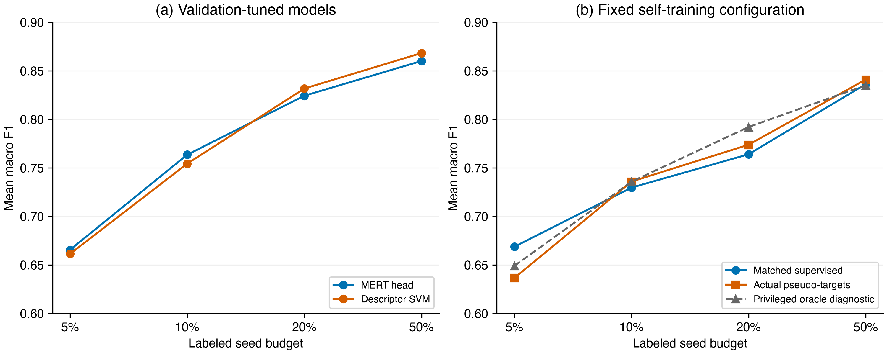
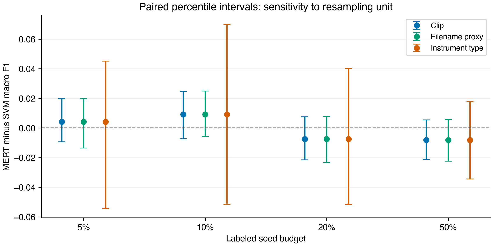
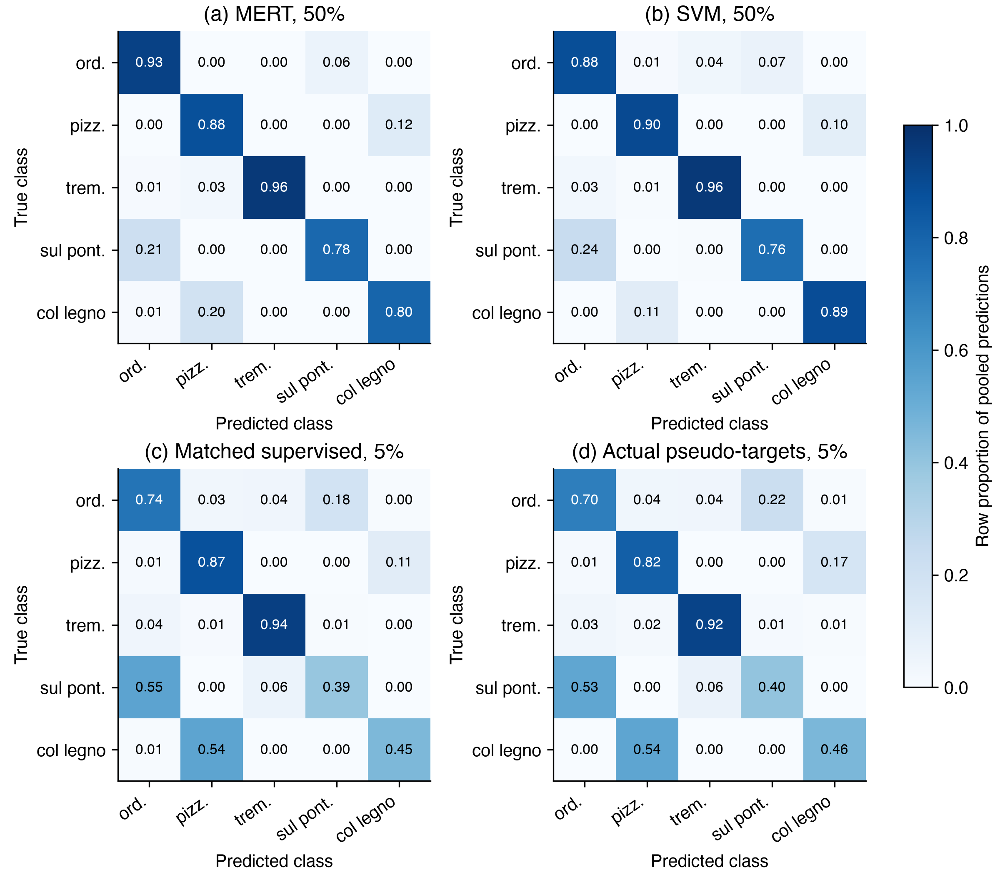

# Auditing Label Boundaries and Model Selection in String Playing-Technique Classification Across Instrument Types

## Abstract

Model rankings in string playing-technique classification can depend on label access and model-selection procedures. We audit those procedures using 3,402 OrchideaSOL string clips covering five techniques and four instrument types. Each outer fold holds out one complete instrument type; limited-label budgets are sampled three times per fold. A MERT classification head and a support vector machine (SVM) using 245 acoustic descriptors select configurations on a separate validation partition and derive class weights and scaling statistics from training indices only. At 5%, 10%, 20%, and 50% labeled-seed budgets, their instrument-type fold-mean macro F1 scores are respectively 0.6655/0.6613, 0.7634/0.7542, 0.8242/0.8316, and 0.8599/0.8681 (MERT/SVM). Repaired self-training scores 0.6364 at 5%, below its matched supervised control of 0.6686; at 10–50%, the differences are smaller and change direction. Paired resampling of the same persisted predictions at the clip, filename-derived recording-proxy, and instrument-type levels produces instrument-type MERT−SVM intervals containing zero at all four budgets. These observations do not establish model equivalence or generalization to new performers. The reproducible contribution is an evaluation procedure that corrects hidden-target access, train/test contamination of fitted quantities, and mismatches between model selection, checkpoints, predictions, and the scope of conclusions.

**Keywords:** playing techniques; music representations; semi-supervised learning; evaluation; leakage; reproducibility.

## 1. Questions and Scope

We ask how a MERT head and a descriptor-based SVM compare under limited labels when an entire instrument type is held out, and whether earlier self-training interpretations survive explicit tracing of pseudo-targets, validation decisions, checkpoints, and predictions. Conclusions are conditional on the four **instrument types** represented in OrchideaSOL. Performer, physical-instrument, and session identifiers are unavailable, so those forms of generalization are untested.

This draft includes only the canonical MERT head, SVM, self-training, and CNN evaluations. Previous layer-weighted-probe, LoRA, SHAP mechanism, and external-transfer findings lack the same completed canonical verification and are excluded from model rankings and causal explanations.

### 1.1 Related work

Kruger and Jacobs (2020) studied bowed-string technique classification using acoustic and Hartley features with SVMs. Li et al. (2024) introduced MERT's music-specific self-supervised representations. We compare a frozen MERT representation with a descriptor SVM on our five-class subset; different tasks and protocols prevent a direct comparison with their published scores.

Oliver et al. (2018) motivate reporting matched supervised controls when evaluating semi-supervised learning. Kapoor and Narayanan (2023) document leakage in machine-learning-based science. Rodríguez-Algarra et al. (2019) examine confounding through controlled music-classification interventions. These studies motivate tracing label access and separating evaluation factors; our simultaneous repairs do not estimate the causal contribution of each historical defect.

### 1.2 Contribution

We present an auditable case study of five string playing techniques under instrument-type holdout. The evaluation traces observed labels and pseudo-target ownership, train-local fitted quantities, validation-selected checkpoints and persisted predictions. It reports limited-label MERT/SVM comparisons and matched self-training diagnostics, with resampling-unit sensitivity on fixed predictions. The supplied statistics can be recomputed without model artifacts; conclusions remain conditional on four observed types.

## 2. Data and Methods

### 2.1 Data and outer split

The source collection is OrchideaSOL (Cella et al., 2020). Its published recommendation uses five folds balanced across instrumentation, pitch, and dynamics. Our custom four-fold instrument-type holdout addresses a different question and does not implement that benchmark split.

The five classes comprise 1,193 `ordinario`, 639 `pizzicato_secco`, 1,041 `tremolo`, 302 `sul_ponticello`, and 227 `col_legno_battuto` clips. The instrument types are violin, viola, violoncello, and contrabass. Macro F1 is the primary measure given this imbalance; per-class F1 and confusion matrices are retained.

The outer evaluation uses four leave-one-instrument-type-out folds. Within each fold, 5%, 10%, 20%, and 50% labeled-seed budgets are sampled in three trials, yielding 12 runs per budget. Reported point estimates first average trials within each fold, then equally weight the four folds. `recording_id` is derived from filenames and is a grouping proxy, not a verified performer or session identifier.

### 2.2 Training and selection

Each labeled seed is divided into a 20% `val_select` partition and an 80% `seed_core`; the latter is further divided into 80% training and 20% early-stopping validation. Thus roughly 64% of seed labels enter model fitting directly. Selection validation, early-stopping validation, and outer test sets are disjoint. The MERT head searches 24 combinations of linear/MLP-256 architecture, learning rate, weight decay, and dropout. The SVM searches 12 C and γ configurations. Both choose configurations on `val_select`, persist the selected checkpoint, reload it, and generate test predictions once. The SVM scaler and class weights, and the MERT class weights, are fitted or computed from the run's training indices only.

Audio descriptors use mono 22,050 Hz audio. The 245 dimensions comprise MFCCs and their first/second deltas (156), spectral contrast (28), onset strength (4), zero-crossing rate (4), RMS energy (4), chroma (48), and log1p time to the first detected onset (1). Each framewise channel contributes mean, standard deviation, and 25th/75th percentiles over the clip. Chroma is retained; these results do not identify its causal effect. The frozen `m-a-p/MERT-v1-95M` encoder receives 24,000 Hz audio; temporal mean pooling of its final hidden layer gives 768 dimensions (Li et al., 2024).

MERT uses full-batch AdamW with learning rates {0.0003, 0.001, 0.003}, weight decays {0.0001, 0.001}, and dropouts {0.1, 0.3}, for at most 200 epochs with patience 20. SVM uses an RBF kernel, C ∈ {0.1, 1, 10, 100}, and γ ∈ {scale, 0.01, 0.001}. The search sizes and computational costs differ; validation separation does not equalize tuning resources.

Repaired self-training carries observed labels and accepted pseudo-labels as explicit `(sample index, target)` pairs. Threshold τ=0.8 was fixed before test evaluation, and the selected iteration among at most five was chosen by observed-label `val_select` F1. Matched supervised, actual pseudo-target, and explicitly privileged oracle-target diagnostics share the split, seed, and observed-label budget. The oracle is neither a usable semi-supervised method nor a mathematical performance ceiling. The earlier implementation appended accepted sample indices but then read targets from the global ground-truth array. Consequently, its performance cannot identify a causal effect of removing test-based iteration selection.

The self-training head is LayerNorm–dropout(0.3)–linear, with full-batch AdamW, learning rate 0.001, weight decay 0.0001, at most 150 epochs per fit, and patience 15. Class weights are recomputed from the explicit target pool. Matching applies within the three self-training conditions. Their partition seeds and fixed configuration differ from the separately tuned MERT/SVM experiment.

The full-label CNN uses 128×128 mel inputs and a fixed final checkpoint after 30 epochs. Because its label budget differs, it is reported separately from the limited-label MERT/SVM comparison.

CNN preprocessing uses 22,050 Hz audio, FFT size 2,048, hop 512, and 128 mel bins. Log-power inputs are cropped to the first 128 frames or right-padded with zeros before imagewise min–max normalization. Training masks up to 15 frequency bins and 20 time frames; evaluation uses no masking. Training uses Adam, learning rate 0.001, weight decay 0.0001, batch size 32, and cosine learning-rate decay.

### 2.3 Provenance and uncertainty

We reloaded and replayed 100 checkpoints from 48 paired MERT/SVM runs and four CNN folds, plus 144 selected checkpoints across the three self-training conditions. Replayed predictions matched saved arrays and manifest metrics. For self-training, accepted `(sample index, predicted target)` records reconstructed every iteration's training pool and matched its hash. The tables, per-class scores, confusion matrices, and resampling analyses use these saved predictions.

For the paired MERT−SVM difference, 1,000 percentile resamples use the same selected test positions for both models. We vary the resampling unit among clips, filename-derived recording proxies, and instrument types. The four-type interval is a **sensitivity calculation conditional on the observed types**; resampling four types does not create a confidence interval for a new-performer population.

## 3. Results

### 3.1 Limited-label model comparison

| Labeled seed | MERT macro F1 | SVM macro F1 | MERT − SVM | Instrument-type resampling 95% interval for difference |
|---:|---:|---:|---:|---:|
| 5% | 0.6655 | 0.6613 | +0.0042 | [−0.0544, +0.0451] |
| 10% | 0.7634 | 0.7542 | +0.0092 | [−0.0514, +0.0698] |
| 20% | 0.8242 | 0.8316 | −0.0074 | [−0.0515, +0.0403] |
| 50% | 0.8599 | 0.8681 | −0.0082 | [−0.0345, +0.0179] |

Table 1. Limited-label scores and paired instrument-type resampling intervals. Means weight the four types equally.

The point-estimate ordering changes with label budget, and all four instrument-type intervals include zero. The table does not identify a clear winner. Zero coverage is also not evidence of equivalence. At the 50% budget, the lower MERT class F1 scores are `col_legno_battuto` 0.7423 and `sul_ponticello` 0.7678; for SVM they are `sul_ponticello` 0.7386 and `col_legno_battuto` 0.8248. Summed confusion counts over repeated trials show prominent confusion between `ordinario` and `sul_ponticello` and between `pizzicato_secco` and `col_legno_battuto`. These counts are repeated test predictions, not unique clips.

### 3.2 Repaired self-training

| Labeled seed | Supervised | Actual pseudo-targets | Explicit oracle diagnostic |
|---:|---:|---:|---:|
| 5% | 0.6686 | 0.6364 | 0.6489 |
| 10% | 0.7295 | 0.7357 | 0.7356 |
| 20% | 0.7639 | 0.7737 | 0.7919 |
| 50% | 0.8361 | 0.8409 | 0.8350 |

Table 2. Matched self-training conditions. Oracle targets are privileged diagnostic information.

At 5%, the weakest pseudo-target class F1 scores are 0.3324 for `sul_ponticello` and 0.4237 for `col_legno_battuto`; at 50%, they rise to 0.6912 and 0.7327. The privileged oracle diagnostic does not always outperform the other conditions because accepted examples and validation-selected iterations can change. We remove the old `0.745 → 0.638` self-training narrative: it compared runs with multiple implementation and configuration differences and cannot isolate a test-selection effect.

Figure 1 summarizes the two protocols.

{width=100%}

Figure 1. Table 1 and Table 2 budget curves. Points average trials within each type, then the four types. Panel (b) compares matched conditions; the oracle is a diagnostic. Panels use different tuning protocols.

### 3.3 Full-label CNN and resampling unit

The full-label CNN obtains a four-fold mean macro F1 of 0.8729. This is a separate label-budget condition. At 50%, the MERT−SVM point difference is −0.0082. Its clip interval is [−0.0212, +0.0054], recording-proxy interval [−0.0224, +0.0059], and instrument-type interval [−0.0345, +0.0179]. The interval changes with the unit; a narrow clip-level interval must not be used as uncertainty for generalization across instrument types.

Figure 2 shows all budgets and resampling units; Figure 3 displays the pooled class confusions.

{width=100%}

Figure 2. The same MERT−SVM point difference with 95% percentile intervals from 1,000 paired draws per unit. Horizontal offsets separate the units visually. Intervals are conditional sensitivity summaries of fixed predictions.

{width=90%}

Figure 3. Row-normalized confusion counts for MERT/SVM at 50% and matched supervised/pseudo-target conditions at 5%. Each panel pools three test predictions per clip across trials (10,206 predictions), rather than counting independent new clips. The entries are pooled row proportions, not the fold-mean F1 values in the tables. Abbreviations follow the class order in Section 2.1.

## 4. Discussion and Limitations

The audit supports procedural conclusions. Accepted pseudo-targets must be passed as explicit training targets rather than reconstructed from a global label array. Class weights and scalers must be fitted within each training partition. Validation roles for early stopping and configuration selection must be distinct, and test predictions must come from the persisted selected checkpoint. Each reported metric and interval is traceable to those predictions.

Holding out an instrument type prevents that type from appearing in both training and test folds, but it does not test independent physical instruments, performers, or recording sessions. `recording_id` is a filename-derived proxy. An interval containing zero does not establish equivalence; an equivalence claim would require a prespecified meaningful margin and more independent groups. We fixed the self-training threshold τ=0.8 before this canonical run, but the dataset had already been explored in earlier experiments. We therefore do not present this as an independent, prospectively preregistered confirmation. The fixed-threshold result also does not establish optimality across thresholds. Layer-weighted probing, LoRA, and external-domain validation remain outside this canonical comparison.

## 5. Conclusion

Within four observed instrument types, neither the tuned MERT head nor the descriptor SVM consistently leads across label budgets. Explicit-target self-training lowers mean F1 at the smallest budget. The audit provides traceable evaluation artifacts, while additional independent groups and controlled interventions are needed to support broader or causal conclusions.

## 6. Reproducibility and Data Availability

Code and input, checkpoint, and prediction hashes are recorded in the manifests under `results/phase1/canonical/mert_svm/`, `cnn/`, and `self_training/`. `src/phase1_canonical_verify.py --draws 1000` and `src/phase1_canonical_selftraining_verify.py` replay checkpoints and regenerate the canonical tables. The detailed verification report and withdrawn historical claims are in `results/phase1/canonical/verification/report.md` and `manuscript_claim_audit.md`.

Figure generation is reproducible with `src/phase1_canonical_figures.py`; the figure manifest links all input CSVs and outputs by SHA-256. Original audio is available from the OrchideaSOL source record under its Ircam Forum license; this repository does not redistribute it. A local release candidate includes sanitized subset metadata, explicit partitions, audited source code, predictions, manifests and reference tables. `src/phase1_release_reproduce.py` recomputes the reported statistics without audio, embeddings or checkpoints. This path verifies saved-prediction statistics and stored target traces; it does not replay checkpoint inference or retrain models. A persistent public release has not yet been deposited. This internal draft therefore does not claim complete public reproducibility.

## References

Cella, C.-E., Ghisi, D., Lostanlen, V., Lévy, F., Fineberg, J., & Maresz, Y. (2020). *OrchideaSOL: An audio dataset of isolated musical notes, including mutes and extended playing techniques* (Version 1.0) [Data set]. Zenodo. [https://doi.org/10.5281/zenodo.3686252](https://doi.org/10.5281/zenodo.3686252).

Kapoor, S., & Narayanan, A. (2023). Leakage and the reproducibility crisis in machine-learning-based science. *Patterns, 4*(9), 100804. [https://doi.org/10.1016/j.patter.2023.100804](https://doi.org/10.1016/j.patter.2023.100804).

Kruger, A. B., & Jacobs, J. P. (2020). Playing technique classification for bowed string instruments from raw audio. *Journal of New Music Research, 49*(4), 320–333. [https://doi.org/10.1080/09298215.2020.1784957](https://doi.org/10.1080/09298215.2020.1784957).

Li, Y., Yuan, R., Zhang, G., Ma, Y., Chen, X., Yin, H., Xiao, C., Lin, C., Ragni, A., Benetos, E., Gyenge, N., Dannenberg, R., Liu, R., Chen, W., Xia, G., Shi, Y., Huang, W., Wang, Z., Guo, Y., & Fu, J. (2024). MERT: Acoustic music understanding model with large-scale self-supervised training. *International Conference on Learning Representations*. [Conference paper](https://proceedings.iclr.cc/paper_files/paper/2024/hash/33dffa2e3d2ab74a783d1a8c292f66d9-Abstract-Conference.html).

Oliver, A., Odena, A., Raffel, C. A., Cubuk, E. D., & Goodfellow, I. (2018). Realistic evaluation of deep semi-supervised learning algorithms. *Advances in Neural Information Processing Systems, 31*. [Conference paper](https://proceedings.neurips.cc/paper/2018/hash/c1fea270c48e8079d8ddf7d06d26ab52-Abstract.html).

Rodríguez-Algarra, F., Sturm, B. L., & Dixon, S. (2019). Characterising confounding effects in music classification experiments through interventions. *Transactions of the International Society for Music Information Retrieval, 2*(1), 52–66. [https://doi.org/10.5334/tismir.24](https://doi.org/10.5334/tismir.24).
